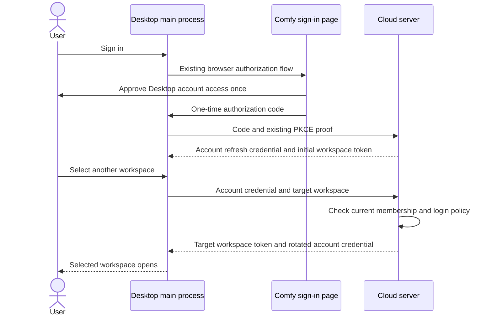

# Desktop account login: implementation plan

Status: proposed. This document describes the implementation. It does not change login behavior.

## Outcome

The user signs in to Comfy Desktop once and can switch between all workspaces they belong to without another approval page.

Keep one account-wide approval for the first release. The approval covers current and future workspace memberships, within the same approved API permissions. The server still checks membership and organization login requirements for every workspace. A later membership change never grants access beyond those checks.

Desktop keeps the account credential in its main process. APIs and the trusted local ComfyUI view continue to receive ordinary tokens for one workspace.

## Is this a backend switch?

Backend work is required. There is no existing switch that supplies the proposed account grant.

The server already identifies the registered `comfy-desktop` client as `first_party` in the consent response. That field describes the client. It does not change the permission model. Authorization codes, stored approvals, and refresh tokens still require one workspace. Refresh rotation explicitly rejects a workspace change.

Ask the backend team to implement and deploy the account-grant contract before enabling it in Desktop. Changing the display classification or hiding the consent page cannot produce this behavior.

## Verified starting point

Inspection date: 2026-10-19. These are source snapshots, not claims about deployed flags or runtime behavior.

| Repository       | Inspected revision                         | Relevant behavior                                                                                                      |
| ---------------- | ------------------------------------------ | ---------------------------------------------------------------------------------------------------------------------- |
| Comfy-Desktop    | `5d4f8f26335fcbbf1d3bc1d78ac13536dcc7254f` | `CloudSession` caches tokens per workspace and starts browser authorization when no usable bundle exists.              |
| cloud            | `e400ff6dc308228ec7cf48c555a3eb8062e7aa93` | OAuth grants belong to one workspace. The token exchange cannot turn that permission into access to another workspace. |
| platform         | `bb1945608970296a682373a9ce3061f3b2ea9a2f` | The account login remains available while the app requests a token for the selected workspace.                         |
| ComfyUI_frontend | `d45abe324c75414c2066115473f54ee65271ea7c` | The hosted consent page submits one workspace. The Desktop bridge already supports workspace switches.                 |

Platform is the reference for separating account login from workspace tokens. Its `services/webSessionTokenSource.ts` requests tokens from an account session. Its `stores/auth.ts` changes the active workspace only after a successful exchange.

Reuse that behavior, without importing Platform's browser cookies, Firebase store, Nuxt proxy, or cross-tab machinery into Electron. The separate Firebase-based Desktop login path is not a complete replacement: the current CloudSession also serves SSO users without a Firebase account.

## Proposed design

An account grant is permission to request workspace tokens. It is not a token that every service accepts for every workspace.

### 1. Agree the smallest server contract

Extend the existing authorization-code and refresh flow. Keep its external browser, loopback callback, PKCE proof, registered redirects, scopes, and token format.

The following field names are proposals for backend review, not existing API fields:

| Operation           | Proposed contract                                                                                                                                          |
| ------------------- | ---------------------------------------------------------------------------------------------------------------------------------------------------------- |
| Start authorization | New Desktop requests `grant_mode=account`. Omitted mode keeps the existing workspace flow. The server permits account mode only for `comfy-desktop`.       |
| Read consent        | The server returns the effective grant mode. Account mode presents account-wide approval without a workspace picker.                                       |
| Approve             | The server records explicit approval for the user, client, resource, and approved scopes at account scope. The client cannot promote a workspace approval. |
| Exchange code       | Return the normal workspace `access_token`, `expires_in`, a rotating account `refresh_token`, and an explicit `grant_mode=account`.                        |
| Switch or renew     | Use `/oauth/token` with `grant_type=refresh_token` and the requested `workspace_id`. Only a stored account grant permits a different workspace.            |
| Response            | Return a token for exactly the requested workspace and the successor account refresh token. Preserve the approved resource and scopes.                     |
| Unsupported mode    | Return a documented unsupported-mode result. Never silently treat an old workspace grant as account-wide.                                                  |

The backend owns the final wire names and OpenAPI definitions. Freeze these before the Desktop implementation uses them.

For the initial workspace, use a valid explicit preference, otherwise an accessible personal workspace, otherwise an accessible team workspace in stable order. Apply organization policy during selection. Return an explicit no-accessible-workspace result if none exists. Do not create a workspace as an authentication side effect.

For an explicit switch, a refusal must refer to that target. Never silently substitute another workspace.

### 2. Implement the account grant in Cloud

Keep workspace grants as the default. Introduce an explicit distinction between account and workspace grants in the existing authorization request, approval, code, and refresh records. Account authority must not depend on a bootstrap workspace ID or a fabricated wildcard workspace.

Use additive migrations. Existing rows remain workspace grants. Generate Ent and OpenAPI output through the repository tools. Report generated files separately in the implementation PR.

At authorization and token issuance:

- Require the server-controlled Desktop policy, an authenticated user, and explicit account-wide approval.
- Preserve current PKCE, redirect, CSRF, single-use code, client/resource, scope, and sign-in-provider checks.
- Resolve the requested workspace from live membership and organization policy before issuing a workspace token.
- Preserve workspace claims and client provenance in the issued access token. Existing resource authorization remains in force.
- Keep an account grant independent of any single membership. Losing workspace A must prevent access to A without preventing a valid request for B.
- Retain refresh rotation, replay detection, expiry, and revocation. Preserve account/client/resource identity across rotation. Only the requested workspace token changes.
- Preserve existing sign-out and account-deletion guarantees. Audit account-grant participation in current revocation and cleanup queries as part of this change.

Do not relax the workspace comparison for legacy refresh tokens. Do not make an existing workspace access token sufficient for account-wide token issuance.

The public `client_id` is not proof that a request came from an official binary. Keep explicit approval and the existing native-client protections. A consent-free login requires a separate review of client impersonation. It is outside this first release. See [RFC 8252 section 8.6](https://www.rfc-editor.org/rfc/rfc8252#section-8.6).

Primary Cloud files: `services/ingest/openapi.yaml`, `services/ingest/server/implementation/oauth_authorize.go`, `oauth_token.go`, `oauth/protocol/request.go`, `oauth/repository/`, and `database/schema/oauth_*.go`. Update `docs/systems/01-auth-identity.md`. Include only the client policy/configuration and generated files required by the final contract.

### 3. Adapt the existing hosted consent page

In `ComfyUI_frontend`, change only the existing consent API/types, view, translations, and focused tests.

The view must use the effective grant mode supplied by the server. Do not infer account authorization from the client name, the `first_party` label, or a query parameter.

For account mode, replace the workspace picker with copy such as: “Allow Comfy Desktop to access workspaces you belong to now or join later.” Preserve the existing permissions detail, identity context, Allow/Cancel actions, and validated redirect.

For later sign-ins with the same approved client/resource/scopes, the server can reuse that approval. Reapproval remains necessary after revocation or an increase in permissions.

Legacy Desktop, CLI, and MCP authorization continues to use the existing workspace page. The account page must not submit a fabricated workspace ID.

Primary files: `src/platform/cloud/oauth/oauthApi.ts`, `OAuthConsentView.vue`, their tests, and affected locale files. Generate API types from the agreed specification where the repository requires it.

### 4. Adapt Desktop's existing CloudSession

Keep `login()`, `switchWorkspace(workspaceId)`, `getAccessToken()`, and the public bridge contract. Implement the behavior inside the existing main-process modules.

| File                           | Narrow responsibility                                                                                                                                                                          |
| ------------------------------ | ---------------------------------------------------------------------------------------------------------------------------------------------------------------------------------------------- |
| `src/main/cloud/pkce.ts`       | Request account mode only when supported and enabled. Preserve current state and PKCE generation.                                                                                              |
| `src/main/cloud/oauth.ts`      | Parse the explicit grant mode and send the workspace selector for an account-grant refresh. Validate the returned token belongs to the expected account and workspace before publishing state. |
| `src/main/cloud/types.ts`      | Distinguish an account credential from a workspace token bundle.                                                                                                                               |
| `src/main/cloud/tokenStore.ts` | Add a versioned encrypted account-credential slot. Preserve legacy vault reads and keep workspace access-token caches separate.                                                                |
| `src/main/cloud/session.ts`    | Reuse valid workspace tokens. Otherwise request one with the account credential. Keep the old authorization path only for legacy/unsupported sessions.                                         |

The account credential stays encrypted with `safeStorage`, with the existing memory-only behavior if secure storage is unavailable. It must never enter the renderer, embedded page, logs, or browser storage.

Do not copy the rotating account refresh token into each workspace bundle. Serialize exchanges that share the account grant. Each queued request must use the latest successor credential and receive a token for its own target.

Preserve the existing “latest user action wins” protection. A completed rotation must save the successor account credential for the same live account, even if a newer workspace choice supersedes its UI result. A completed operation must never restore credentials after sign-out or an account change.

Publish the new active workspace only after success. A temporary network failure leaves the previous workspace usable. A denied target shows the existing error behavior and does not open another consent page. Clear account and workspace credentials together on sign-out or account change.

Continue sending only the selected workspace token through `src/main/lib/embeddedSession.ts`. Its existing trusted-sender and exact-workspace checks remain part of the contract. The workspace picker and generated bridge package need no new API.

### 5. Handle existing installs and rollout

1. Ship the additive backend contract with account-mode issuance disabled. Keep old grants and clients working.
2. Deploy the hosted consent page that understands both modes. Keep account-mode issuance disabled until that page is available.
3. Enable the server policy for Desktop in staging. Validate social login and SSO with the same flow.
4. Ship Desktop support. Select the new mode through a documented server capability/rollout signal. Missing support selects the legacy flow.
5. Let existing installs keep their current grant. On the next explicit sign-in or uncached workspace switch, offer one account-wide authorization. Canceling it preserves the existing session.
6. After a successful account authorization, replace the old local credential set atomically. Do not upgrade old permissions silently or bulk-authorize every workspace.
7. Enable production issuance after the checks below pass. Reuse existing login failure and token-exchange signals to observe the rollout.

For rollback, disable new account-grant issuance and keep serving already issued account grants while a compatible client fix ships. Do not roll the backend back past the schema/reader support and leave users with unreadable grants. If account grants must be revoked, require one explicit sign-in. Never silently widen a legacy grant to compensate.

The backend team must confirm the capability signal and deployment order with the contract. Do not treat arbitrary timeouts or authorization denials as “server does not support this.”

## Focused validation

Use existing fixtures and suites. Keep time under test control. Use deferred promises for concurrency, fake clocks for expiry, and event/locator assertions for UI readiness. CI must not depend on real Google/SSO login or fixed sleeps.

| Layer       | Behavior to prove                                                                                                                                                                                      |
| ----------- | ------------------------------------------------------------------------------------------------------------------------------------------------------------------------------------------------------ |
| Backend     | One approved account grant obtains tokens for A and B. A nonmember workspace is refused.                                                                                                               |
| Backend     | Membership removal blocks subsequent token issuance and API use for A, while B remains usable.                                                                                                         |
| Backend     | Dynamic MCP clients, other seeded clients, and old Desktop grants cannot request account authority or cross workspaces.                                                                                |
| Backend     | Missing approval, wrong PKCE/redirect/client/resource, increased scopes, revoked/expired grants, and disallowed organization login remain refused. Extend existing parameterized tests where possible. |
| Backend     | Rotation preserves account identity, replay protections, scope narrowing, and current cleanup/revocation behavior.                                                                                     |
| Hosted page | The server's account mode omits the workspace picker and submits account approval. Legacy mode still requires its workspace. Cancel and invalid redirects remain covered.                              |
| Desktop     | An uncached A-to-B switch exchanges a token without opening the browser. A later renewal also uses the account grant.                                                                                  |
| Desktop     | Concurrent switches and renewals use each successor refresh credential once. Late results cannot change the selected workspace or restore a signed-out account.                                        |
| Desktop     | Restart restores the encrypted account grant. Legacy vaults remain readable. Account change/sign-out clears all associated credentials. No account credential reaches the bridge.                      |
| Desktop     | A denied target or temporary error leaves the prior workspace intact. Unsupported servers retain legacy behavior.                                                                                      |

Before implementation PRs are ready:

- Cloud: use the `cloud` CLI for the affected unit/integration modules, migration validation, `gen check`, formatting, and lint. Preserve the OpenAPI/registered-route invariant if routing changes.
- Frontend: run focused `pnpm test:unit` suites and checks required for the touched files. Use server-supplied facts, typed errors, existing localization, and current guidance. Avoid repo-wide commands that its `AGENTS.md` forbids for local verification.
- Desktop: run the affected `pnpm test` suites, then the required commit-hook typecheck, lint, and format checks. Run bridge generation checks only if the exported contract changes.
- Staging: perform one real login, A-to-B-to-A switches, restart, membership removal, and sign-out. Include one social-login account and one SSO account. Record results without credentials.

Acceptance: one initial approval. No further consent during valid workspace switches or token renewal. Only current memberships work. Legacy clients still work.

## Scope and delivery

Use three dependent implementation PRs: Cloud contract/storage, hosted consent, then Desktop integration. The backend PR can merge disabled before the other two. Keep each PR focused on its own repository and dependency.

Platform needs no changes. Rewriting auth around Firebase, copying Platform UI, changing permissions or billing, adding session-management UI, replacing the OAuth library, and modifying unrelated clients are outside scope.

Follow each repository's current guidance at implementation time. Keep functions small and typed. Add no dependency or abstraction without a direct need. Behavioral tests must establish the feature, not mirror the implementation. Fix test flakiness rather than adding retries or disabling tests.

Every implementation PR must separate behavior from test coverage. Report product and test file paths/counts, additions, deletions, and percentage of changed lines. Report documentation, configuration, generated files, lockfiles, and vendored code separately when present. Exclude merge-only changes. Do not hide a large generated diff inside the product-code count.

## Backend handoff

> Can we add an opt-in account grant for `comfy-desktop`, with one account-wide approval and workspace tokens requested through that grant? The current `first_party` label does not enable this. Please confirm the request/response fields, rotation and revocation behavior, capability signal, and staging rollout. We will keep workspace API tokens and current membership/SSO checks, and leave legacy Desktop and MCP grants workspace-bound.

This handoff is draft text, not a message sent to the backend team.

## Source references

- [Desktop workspace switching](../src/main/cloud/session.ts), [OAuth transport](../src/main/cloud/oauth.ts), [encrypted storage](../src/main/cloud/tokenStore.ts), and [trusted embedded session](../src/main/lib/embeddedSession.ts).
- [Cloud client classification](https://github.com/Comfy-Org/cloud/blob/e400ff6dc308228ec7cf48c555a3eb8062e7aa93/services/ingest/server/implementation/oauth_authorize.go#L298-L319), [client schema](https://github.com/Comfy-Org/cloud/blob/e400ff6dc308228ec7cf48c555a3eb8062e7aa93/database/schema/oauth_client.go), and [refresh identity invariant](https://github.com/Comfy-Org/cloud/blob/e400ff6dc308228ec7cf48c555a3eb8062e7aa93/services/ingest/server/implementation/oauth/repository/refresh.go#L706-L724).
- [Cloud token exchange](https://github.com/Comfy-Org/cloud/blob/e400ff6dc308228ec7cf48c555a3eb8062e7aa93/services/ingest/server/implementation/cloud_jwt.go#L106-L138) and [OAuth token-mint restrictions](https://github.com/Comfy-Org/cloud/blob/e400ff6dc308228ec7cf48c555a3eb8062e7aa93/services/ingest/server/implementation/partner_node_session.go#L460-L484).
- [Platform account-backed workspace tokens](https://github.com/Comfy-Org/platform/blob/bb1945608970296a682373a9ce3061f3b2ea9a2f/services/webSessionTokenSource.ts), [workspace switching](https://github.com/Comfy-Org/platform/blob/bb1945608970296a682373a9ce3061f3b2ea9a2f/stores/auth.ts#L348-L385), and [Firebase exchange adapter](https://github.com/Comfy-Org/platform/blob/bb1945608970296a682373a9ce3061f3b2ea9a2f/services/accountSession.ts).
- [Hosted consent view](https://github.com/Comfy-Org/ComfyUI_frontend/blob/d45abe324c75414c2066115473f54ee65271ea7c/src/platform/cloud/oauth/OAuthConsentView.vue) and [consent request](https://github.com/Comfy-Org/ComfyUI_frontend/blob/d45abe324c75414c2066115473f54ee65271ea7c/src/platform/cloud/oauth/oauthApi.ts).
