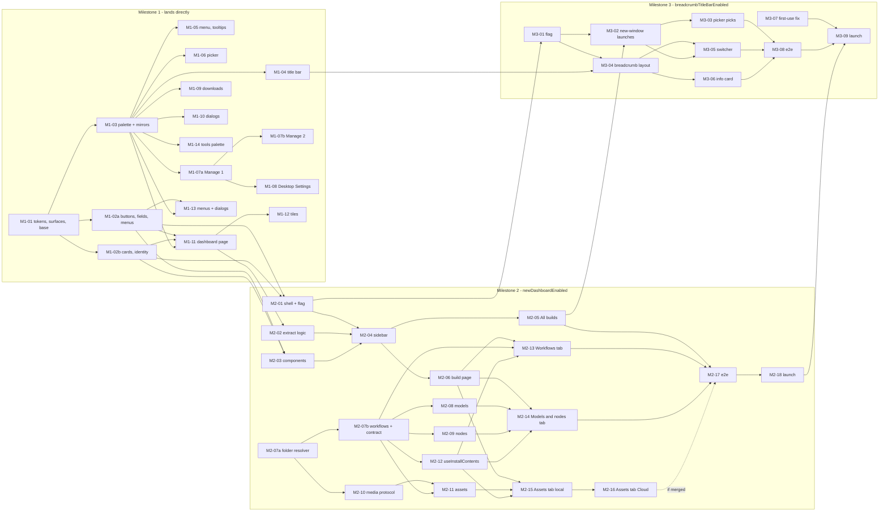

# Desktop redesign: development plan for Milestones 1–3

| | |
| --- | --- |
| Status | Draft for engineering review |
| Scope | Milestone 1 (Design system), Milestone 2 (Builds dashboard), Milestone 3 (Breadcrumb title bar) |
| Base | `main` @ `9c43562d` (v1.1.6). All line references are to that commit. |
| Visual source of truth | The design prototype (see [§3.1](#31-source-of-truth)). Its Prototype menu shows each milestone. |

This plan turns the approved prototype into production code. Every screen reads real data. Nothing in production code is mock data, a placeholder value or an estimate we cannot compute.

It is written for the engineers who build it and the reviewers who merge it. Each pull request (PR) below is small, does one thing, and can be reviewed in one sitting.

---

## Contents

1. [Summary](#1-summary)
2. [Decisions](#2-decisions)
3. [Design system contract](#3-design-system-contract)
4. [Engineering rules for every PR](#4-engineering-rules-for-every-pr)
5. [Milestone 1: Design system](#5-milestone-1-design-system)
6. [Milestone 2: Builds dashboard](#6-milestone-2-builds-dashboard)
7. [Milestone 3: Breadcrumb title bar](#7-milestone-3-breadcrumb-title-bar)
8. [Sequencing and parallel work](#8-sequencing-and-parallel-work)
9. [Risks](#9-risks)
10. [Not in these milestones](#10-not-in-these-milestones)
11. [Appendix](#11-appendix)

---

## 1. Summary

| Milestone | What users get | Rollout | PRs |
| --- | --- | --- | --- |
| **M1 Design system** | The new design system (tokens, components, gradients). The dashboard and everything it and its menus open are restyled: title bar, app menu, instance picker and Manage, Desktop Settings, downloads, tooltips, dialogs. Performance Tests and Benchmarks get the new palette only. | Lands directly on `main`, inside one release cycle | 16 |
| **M2 Builds dashboard** | Instances and builds become one concept, **Builds**. A sidebar of builds; **All builds** is the landing page; a page per build with **Workflows**, **Models & nodes** and **Assets** tabs; the workspace switcher at the foot of the sidebar. | Behind the `newDashboardEnabled` setting | 19 |
| **M3 Breadcrumb title bar** | Every window's title bar becomes a breadcrumb: **Builds › build ⌄**. Hovering the build shows its info card; the chevron switches builds. Each build opens in its own window and the dashboard window stays. | Behind the `breadcrumbTitleBarEnabled` setting (needs M2) | 9 |

Most PRs in a milestone can run in parallel. [§8](#8-sequencing-and-parallel-work) shows the lanes and what is stacked.

---

## 2. Decisions

These were agreed before writing this plan. Do not reopen them in PRs; raise them with the product owner instead.

| # | Decision | Consequence for the code |
| --- | --- | --- |
| D1 | The new **Void** palette reaches only the screens in scope for M1. | The install wizard, first-run takeover and progress screens keep today's colours and shapes. The palette is applied by scope, not by changing the shared variables ([§3.7](#37-legacy-palette-bridge)). |
| D2 | Performance Tests and Benchmarks get the **palette only** in M1. | They inherit the colours; their own components are not reworked. Shared primitives they use (selects, dialogs) follow the shared rules in [§3.7](#37-legacy-palette-bridge). |
| D3 | M1 lands **directly**. M2 and M3 are **behind flags**. | M1 PRs merge within one release cycle so a release never ships half of it. M2 and M3 ship dark until their launch PRs. |
| D4 | The build page has **Workflows**, **Models & nodes** and **Assets** tabs. Activity and Versions are not in M2. **Assets is a stretch lane.** | Each tab reads real data. Assets needs a media layer ([§6.4](#64-data-contracts)). If the Assets PRs (M2-15, M2-16) have not merged when the Workflows and Models & nodes tabs have, M2 launches without the Assets tab. |
| D5 | "Instance" and "build" become one concept, **Builds**, in **user-facing copy only**. The Comfy Developer Platform's workspace builds are part of the same concept. | Code, IPC channels, types (`Installation`, `installationId`) and telemetry names keep today's install vocabulary, and **new code uses it too** (`install-contents:*`, `install-switcher`, `InstallPage.vue`). Copy that would read oddly after the change ("Create a Build from this instance") gets new wording, approved in the launch PR (M2-18). |
| D6 | In M3 each build opens in **its own window**; the dashboard window stays. One window holding many builds is a later milestone. | M3 changes where launches go, not how many views a window has. |
| D7 | This plan lives in the repo as markdown. | Update it in the same PR when a decision changes. |

---

## 3. Design system contract

Every M1–M3 surface uses the design system built in the prototype: its tokens, its components and its gradients. **Do not deviate from it.** No new colours, radii, shadows, font sizes or one-off components in feature PRs.

If something cannot be built with the system, stop. Raise it with design, then change the system in a design-system PR ([§3.10](#310-changing-the-design-system)).

### 3.1 Source of truth

- **Prototype code.** The branch `PabloWiedemann/instances-landing-prototypes`. Push it as a reference branch before kickoff. **It is never merged.**
  - The design system lives in `src/renderer/src/design/landing/ui/`.
  - The approved chrome skin is in `src/renderer/src/assets/chrome-void.css`.
- **Prototype app.** Run the reference branch (`pnpm dev`) and open the **Prototype** menu (sliders icon, title bar). Pick the milestone you are building. Every UI PR compares its screenshots against that variant.

| Milestone | Copy the look from | Read for behaviour, do not copy |
| --- | --- | --- |
| M1 | `parts/milestones/ClassicDashboard.vue`, `parts/InstanceCard.vue`, `parts/NewInstanceCard.vue`, `assets/chrome-void.css` | — |
| M2 | `variants/VariantModes.vue` (shell), `parts/env/SidebarGroup.vue`, `parts/WorkspaceMenu.vue`, `parts/ContextSwitchSub.vue`, `pages/modes/EnvironmentsList.vue` (All builds), `pages/modes/EnvironmentDetail.vue` (build page), `pages/project/ProjectWorkflows.vue` (Workflows), `pages/env/EnvModels.vue` (Models & nodes), `pages/AssetsPage.vue` (Assets) | `main/lib/ipc/registerDesignHandlers.ts` (workflow listing) |
| M3 | `parts/nav/TitleBarBreadcrumb.vue`, `comfyTitlePopup/MenuView.vue` (switcher and info card rows) | `comfyTitleBar/TitleBarApp.vue` (switcher items, info card items, hover handshake), `main/popups/titlePopup.ts` (pick routing) |

The prototype's **behaviour** code is not production code. Its local-storage bridge between windows, its mock data and its view-switching hacks must not be copied. Only its **look** is the contract; production behaviour is specified in this plan.

### 3.2 Where it lives in production

```
src/renderer/src/design-system/
  index.css           imports tokens, base, surfaces, palette (imported once from assets/main.css)
  tokens.css          Tailwind v4 @theme static: colours, type, radius, shadow, blur, motion
  base.css            .ds-root scope, @layer base defaults, @utility heading-gradient / edge-shine
  surfaces.css        .ds-page (glass page), .glass-titlebar, .ds-content (content panel + glow)
  palette-void.css    everything that only applies under .palette-void (§3.7)
  cn.ts               clsx + tailwind-merge, taught the custom scales
  portal.ts           PORTAL_TO
  menu.styles.ts      floatingSurface, menuItem
  components/         one .vue per component + its *.variants.ts
  README.md           the rules below, and token tables written from tokens.css
```

**Renames from the prototype.** Production code must not carry "proto" names.

| Prototype | Production |
| --- | --- |
| `.proto-ui` | `.ds-root` |
| `.proto-shell` | `.ds-page` |
| `.proto-main` | `.ds-content` |
| `.proto-sidebar` (`ui/sidebar.css`) | `.ds-sidebar`, ported with the sidebar in M2-04 |
| `chrome-void.css` (one global skin) | `palette-void.css` plus per-component scoped styles ([§3.7](#37-legacy-palette-bridge)) |

Do not import from `src/renderer/src/design/` (the prototype folder). It is not on `main`.

### 3.3 Dependencies

Added in M1-01, at the prototype's versions. Do not upgrade them in the same PR.

| Package | Version | Why |
| --- | --- | --- |
| `reka-ui` | `2.6.2` | Primitives for every interactive pattern (menus, tabs, toggle group, tooltip, select). Focus, keyboard and ARIA come from Reka. |
| `cva` | `1.0.0-beta.4` | Variant files (`*.variants.ts`) |
| `clsx` | `^2.1.1` | Class composition in `cn()` |
| `tailwind-merge` | `^3.7.0` | Class merging in `cn()`, taught our custom scales |

ESLint: copy the prototype's override that turns off `vue/require-default-prop`, scoped to `src/renderer/src/design-system/**/*.vue` only. Reka-style wrappers take their defaults from Vue 3.5 props destructuring, which the rule cannot see.

### 3.4 Tokens

Port the prototype's `tokens.css` **verbatim**. Its `@theme` block (lines 15–99) goes to `tokens.css`; its scope reset, base layer and the two utilities (lines 101–177) go to `base.css`. Two deliberate differences:

- **`@theme static` instead of `@theme`.** Tailwind v4 only emits a theme variable when a utility uses it: in the running prototype `--shadow-highlight` does not exist on the page while `--radius-panel` does. Legacy scoped CSS reads tokens as `var(--…)`, so every token must always exist.
- **The README.** Its token table is out of date. It lists text sizes (`micro`, `meta`, `ui` 12.5, `body`, `heading` 15), radii (`inner`, `dialog`), shadows (`glass`, `dialog`) and colours (`canvas`, `popover-background`, `glass`, `scrim`) that `tokens.css` does not define. Rewrite the table from `tokens.css`; do not add the tokens.

| Group | Tokens (Tailwind utility → value) |
| --- | --- |
| Surfaces | `app-background` oklch(0.19 0.003 285) (glass page) · `content-background` oklch(0.14 0.005 285) (inset panel) · `card-background` oklch(0.23 0.008 285) · `card-background-hover` oklch(0.265 0.009 285) · `secondary-background` white 6% · `secondary-background-hover` white 10% · `media-overlay` black 55% · `titlebar-background` oklch(0.145 0.003 285) (the browser preview's stand-in bar only; production chrome uses the glass base, [§3.7](#37-legacy-palette-bridge)) |
| Text | `base-foreground` oklch(0.955 0.002 285) · `muted-foreground` oklch(0.76 0.006 285) · `subtle-foreground` oklch(0.6 0.008 285) |
| Accent | `inverted-background` oklch(0.96 0.002 285) (the one white CTA) · `inverted-background-hover` · `inverted-foreground` oklch(0.13 0.004 285) |
| Borders | `border-default` white 8% · `border-strong` white 14% · `border-focus` white 45% |
| Status | `status-running` oklch(0.78 0.15 155) · `status-danger` oklch(0.62 0.19 25) |
| Type | `text-ui` 13/20 · `text-heading` 16/24 · `text-title` 22/28 · `text-display` 34/40 |
| Radius | `panel` 16 · `card` 12 · `control` 8 · `min` 4 |
| Shadow | `elev` · `elev-hover` · `popover` · `highlight` |
| Other | `blur-glass` 28px · `ease-out-expo` · `animate-pop-in` · `animate-fade-in` |

Rules:

- **Semantic tokens only.** Never write a raw colour, radius, shadow or font size in feature code. In legacy scoped CSS, use `var(--color-…)`, `var(--radius-…)`, `var(--shadow-…)`.
- **4px grid.** Every size, line-height and control height is a multiple of 4. Font sizes are the only exception.
- **Nested radius.** Inner radius = outer radius − the padding between them, never below `min`: panel 16 /p8 → card 8; card 12 /p4 → media 8; menu 12 /p4 → item 8; media 8 /inset 4 → chip 4.
- **Dark only.** A build window's title bar takes ComfyUI's colour, which can be light (`.is-light`). Anything drawn there uses the title bar's existing theme variables, not Void tokens (M3-04).

### 3.5 Components

Port a component **only in the PR that first needs it** (M1-02a, M1-02b and M2-03). Do not port the whole prototype kit; unused components are dead code.

| Pattern | Component | Variants | Ported in |
| --- | --- | --- | --- |
| Buttons | `Button` | `primary` (the one white CTA per surface), `secondary`, `ghost`, `subtle`, `overlay`, `link`, `destructive`; sizes `sm md lg icon-xs icon-sm icon`; `block` | M1-02a |
| Text entry | `Input`, `SearchInput` (share `field.variants.ts`; focus ring on the shell) | sizes | M1-02a |
| Menus | `DropdownMenuContent`, `DropdownMenuItem`, `DropdownMenuLabel`, `DropdownMenuSeparator`; Reka `DropdownMenuRoot` / `Trigger` used directly | — | M1-02a |
| Overlays | `Tooltip` | `wrap` | M1-02a |
| Surfaces | `Card` | `elevated` (edge-shine + elev), `glass`, `dashed` (create tiles), `inset`; `padding`; `interactive` | M1-02b |
| Identity | `Avatar`, `Badge`, `StatusDot`, `LocationIcon` (the one this-computer / Comfy Cloud mark) | per variants files | M1-02b |
| Layout | `PageHeader`, `SectionHeader`, `EmptyState` | — | M2-03 |
| Choice | `Tabs`, `SegmentedControl` (`contained`, `plain`), `Select` | — | M2-03 |
| Menus | `DropdownMenuSubTrigger`, `DropdownMenuSubContent` (the workspace switcher's submenu) | — | M2-03 |
| Media | `MediaCard` | — | M2-03 |

**Prototype `parts/` are feature components, not the design system.** `WorkflowCard`, `AssetTile`, `CloudSignInCta`, `FolderFilterMenu`, `InstanceGlyph`, `WorkspaceAvatar`, `env/RunsOn`, `env/EnvLaunchButton` and their siblings are rebuilt in the feature PR that first uses them, under that feature's folder, from design-system components. [§3.10](#310-changing-the-design-system) does not apply to them. `parts/GraphPreview.vue` draws a fake graph from mock data and is **not** ported ([§4.1](#41-principles-small-clean-contained)).

### 3.6 Surfaces and gradients

Copy these recipes **byte for byte** from the prototype's `surfaces.css` and `tokens.css`. Do not re-derive, simplify or "clean up" the numbers; they were tuned visually.

| Surface | Recipe | Used on |
| --- | --- | --- |
| **Glass page** (`.ds-page`) | Base `--glass-base` oklch(0.19 0.003 285) plus four layers. **Top sheen:** white 3.5% → transparent, 100% × 19vw. **Warm wash:** `radial-gradient(120vw 34vw at 0 var(--glass-y), oklch(0.27 0.007 310 / .5), transparent 70%)`. **Cool wash** (bottom left): `radial-gradient(110% 60% at 10% 100%, oklch(0.26 0.007 245 / .5), transparent 75%)`. **Mid wash:** `radial-gradient(90% 50% at 60% 55%, oklch(0.22 0.003 285 / .5), transparent 80%)`. `--glass-y: -37px` (`TITLEBAR_HEIGHT + 1`) lays it out in window coordinates. | Dashboard window body (M1 page, M2 sidebar area) |
| **Title-bar glass** (`.glass-titlebar`) | The same base, sheen and warm wash at `--glass-y: 0`, `background-origin: border-box`, transparent bottom border, so the glass runs across the seam. | Dashboard window's title bar only. Build windows keep ComfyUI's colour. |
| **Content panel** (`.ds-content`) | 8px inset, `radius-panel` (16), **no border and no shadow**. Background, top to bottom: overhead light `linear-gradient(180deg, white 3.5%, white 1.2% 260px, transparent 520px)`, the baked **teal and plum mesh** (inline SVG, 5 radial gradients, seed 7), then `content-background`. | The scrolling content area (M1 page, M2 pages) |
| **Glow** (`.ds-content::before`) | Two radial gradients from the top (soft plum light at 8% and white at 3%), 900px tall, masked out by 55% of its height, `z-index: -1` under the content. | Same |
| **Edge shine** (`edge-shine`) | Card border becomes transparent; a 1px top-edge highlight fades down the sides (`--shine` 0.14, 0.22 on hover). | `Card variant="elevated"` |
| **Heading gradient** (`heading-gradient`) | Text fill from oklch(0.995 0.001 285) at 30% to oklch(0.7 0.012 285). | Display headings (the dashboard's wordmark title) |

The prototype's `-44px` browser-preview rule and its `.proto-ui:has(> .glass-titlebar)` selector are preview-only. Do not port them.

### 3.7 Legacy palette bridge

Most in-scope chrome is legacy SFCs whose scoped CSS reads legacy variables (`--neutral-*`, `--bg`, `--text`, `--accent`, …). M1 does not rewrite them. `palette-void.css` holds **everything that only applies under the class `palette-void`**.

**1. Colours.** The legacy variable names, re-pointed to Void. Take the values, and the intent of each, from layer 1 of the prototype's `chrome-void.css`.

- **Selector:** `:root.palette-void[data-theme='dark'], .palette-void`. Every renderer sets `data-theme='dark'` on `<html>`, and `main.css:77` defines the legacy colours under `[data-theme='dark']`. On `<html>` the first selector out-ranks that block whatever the load order. On a descendant, the plain class re-declares the variables for its subtree.
- **Re-declare every derived variable.** A variable defined at `:root` as `var(--neutral-800)` resolves there, and descendants inherit the resolved value; re-pointing `--neutral-800` lower down does **not** update it. The bridge re-declares each semantic variable derived from the ramp (`--titlebar-bg`, `--surface`, `--modal-surface-bg`, `--tooltip-*`, …), as `chrome-void.css` layer 1 does.
- **A `data-theme` attribute inside a scope wins.** It re-declares the legacy colours for its own subtree. `BrandBackground` sets one (`BrandBackground.vue:18`); M1-11 removes it from the dashboard.
- **The title bar colour** is the glass base, oklch(0.19 0.003 285) ≈ `#141415`, in both `--titlebar-bg` and `TITLEBAR_BG` ([§3.8](#38-main-process-mirrors)). The prototype's 0.145 value for `--titlebar-bg` is not used.

**2. Shapes of shared legacy code.** Global legacy classes (`button.primary` at `main.css:443`, `button.brand-secondary` at `main.css:720`) and shared primitives that out-of-scope screens also use (`BaseSelect`, its options and listbox) take their new shapes **only under `.palette-void`**, so the wizard keeps today's look. Shapes of components used only in scope go in their own scoped styles (M1-04 to M1-09). Nothing uses `:root.chrome-void`-style specificity overrides.

**3. Where the class goes.**

- **Title bar, title popup, tooltip and system modal renderers:** on `<html>` (M1-03). Everything they draw is in scope, including Manage, Desktop Settings and Downloads (all title popups), and everything they teleport.
- **Panel renderer: never on `<html>`.** The wizard, first-run and progress screens live there. Instead:
  - on the roots of `ChooserView` (M1-11), `PerformanceTestView` and `BenchmarksView` (M1-14);
  - **always** on the teleported roots of the shared dialogs: `ModalDialog`, `BaseModal`, `BaseAlert` and `AnnouncementModal` (M1-10; see item 4);
  - on the teleported roots of legacy floating elements **only when they open inside a scope**: `BaseSelect`'s listbox and `ui/Tooltip` (M1-03), `ContextMenu` and `WhyTryCloudModal` (M1-13). `WhyTryCloudModal` also opens from the first-run screen, which keeps today's look.
- **How a teleported element knows its scope.** `<Teleport to="body">` leaves the DOM tree, so the element inherits nothing from its panel ancestors. Vue's component tree is unaffected, so the scope travels by provide/inject:
  - a scoped root takes its class from `providePaletteScope()`;
  - a teleported element binds `usePaletteScope()` on its teleported root.

  M1-03 adds both functions in `src/renderer/src/composables/usePaletteScope.ts`.

**4. Accepted exceptions.**

- The shared dialog primitives (`ModalDialog`, `DialogHost`, `BaseAlert`, `BasePrompt`, `BaseActionSheet`, `BaseModal`) float over every screen. They take the Void palette **everywhere**, including dialogs raised from the wizard, `TermsModal` (first-run) and `McpSetupModal`. One dialog style; no per-caller variants.
- Performance Tests and Benchmarks open `BaseSelect` inside a scope, so their selects take the new shape too (D2).

### 3.8 Main-process mirrors

Some chrome colours and sizes are duplicated in the main process, because those renderers have no stylesheet or are drawn by the OS. Change each pair **in the same PR** and update the tests that assert them.

| Constant | Today | Void | Where, and PR |
| --- | --- | --- | --- |
| `TITLEBAR_BG` | `#211927` | `#141415` (glass base) | `src/main/lib/theme.ts:19`. It feeds the OS window-controls overlay, the dashboard window's `lastTheme` and the panel's loading fill (the dashboard window's first paint). **M1-03.** |
| Update splash | `SPLASH_PURPLE.bg = TITLEBAR_BG` | `#211927`, unchanged | `theme.ts:61`. The splash is out of scope: give it its own constant so it does not follow `TITLEBAR_BG`. **M1-03.** |
| Coachmark theme | `bg #211927, text #ffffff, border #38303d, accent #e3ff3c` | `bg #1c1c21, text #f1f1f3, border #2d2d31, accent #f1f1f3` | `src/main/popups/titleCoachmark.ts:61-64`. **M1-03.** |
| Tooltip theme | `bg #211927, text #ffffff, border #38303d` | `bg #f1f1f3, text #070709, border #f1f1f3` (inverted) | `src/main/popups/titleTooltip.ts:59-62` **and** the renderer defaults in `TitleTooltipApp.vue:66-69`. **M1-03.** |
| Popup scrim | `rgba(33,25,39,0.4)` | `rgba(10,10,11,0.4)` | `src/main/popups/titlePopup.ts:613-625`. **M1-03.** |
| Menu row height | `POPUP_ITEM_HEIGHT = 28` | `32` | `titlePopup.ts:719-731` with `MenuView.vue`; tested in `titlePopup.test.ts:120-145`. **M1-05.** |
| `COMFY_BG` | `#171717` | **unchanged** | `createHostWindow.ts:570` (an e2e test asserts it) |

### 3.9 Rules

1. **One component per pattern.** A second search field is `SearchInput`, not a new component.
2. **Design-system components are styled with utilities only.** `main.css` styles bare `button`, `input`, `label` and `* { margin; padding }` outside any cascade layer. `.ds-root` hands those back to Tailwind; scoped CSS on those elements inside `.ds-root` would be overridden.
3. **New and rebuilt surfaces sit inside `.ds-root`.** Floating surfaces portal to `body` and carry `.ds-root` themselves (`menu.styles.ts`, `PORTAL_TO`).
4. **Tooltips and Reka roots.** Never put a `Tooltip` between a Reka `*Root` and its `*Trigger`. Wrap the whole root with `<Tooltip wrap>` instead; two poppers cannot share an anchor.
5. **Icons are `lucide-vue-next`.** One icon set.
6. **Motion follows the system.** `ease-out-expo` for entrances, under 300ms, and no animation on keyboard-initiated actions. Respect `prefers-reduced-motion`.
7. **Accessibility comes from Reka.** Do not hand-roll focus management, roving tab index or ARIA for patterns Reka covers.

### 3.10 Changing the design system

- Only **design-system PRs** edit `src/renderer/src/design-system/`. In this plan those are M1-01, M1-02a, M1-02b, M1-03 and M2-03.
- A feature PR **never** edits it. If a screen needs something the system lacks, open a design-system PR with design sign-off first and stack the feature PR on it.
- Changing a token value is a design decision. Its PR shows before/after screenshots of every surface that uses the token.

---

## 4. Engineering rules for every PR

### 4.1 Principles: small, clean, contained

Write clean code (Robert C. Martin's *Clean Code*) and be frugal with changes. Concretely:

- **Smallest change that does the job.** Each PR has one goal, stated in one sentence at the top of its description. Everything in the diff serves that sentence.
- **No side quests.** No drive-by refactors, renames, formatting churn, dependency bumps or "while I'm here" fixes. Found something? File an issue and link it.
- **Reuse before adding.** Use the existing stores, composables, IPC handlers and components first; this plan names them. Add an abstraction only when a second real caller exists, in the same PR or in a later PR of this plan named in the description.
- **Minimal blast radius.** Touch only the files the goal needs. A flagged PR proves with a test that nothing changes while its flag is off.
- **Delete what you replace,** in the same PR. No commented-out code, no "old" copies, no unused exports.
- **Names reveal intent.** Use nouns for data and verbs for functions; no `data`, `info`, `manager`, `helper` or `util` names. New code keeps the install vocabulary (D5).
- **Small functions that do one thing**, one level of abstraction each, with few arguments and no hidden side effects.
- **Comments explain why,** not what. Cite the issue or PR number when a line exists because of one.
- **Real data or an honest empty state.** No mock data, no placeholder numbers, no fake previews, and no estimates we cannot compute: "starts in ~20 s" is out unless measured. When data is missing, show a designed empty state.
- **Fail closed and visibly.** Expected failures return `{ ok: false, message }` and render an error state; unexpected ones log with a `[tag]` prefix.

### 4.2 Repository standards

These come from `AGENTS.md`, `TESTING.md`, CI and the code itself.

| Rule | Reference |
| --- | --- |
| **PR title is a conventional commit.** Release notes are built from `feat` and `fix` subjects only. So use `feat` / `fix` for what users see on release (M1 restyles, launch PRs, bug fixes); `chore` for design-system plumbing and for flagged work users cannot see yet; `refactor` for no-behaviour changes; `test` for test-only PRs. Each PR below carries its type. | `version-bump.yml:199-212` |
| **PR description includes the change breakdown:** product vs test code, with file counts and paths, added and deleted lines, and the share of total changed lines (added + deleted). List docs, config, generated files, lockfiles, locales and vendored code separately; merge-only changes are not counted. | `AGENTS.md:3-7` |
| Typecheck, lint and `format:check` pass locally (husky pre-commit). Unit, integration and E2E pass in CI on macOS, Windows and Linux. | `.husky/pre-commit`; `ci.yml` |
| **Zero flaky tests.** No fixed sleeps (`waitForTimeout` is never used); wait on causes with `expect.poll`. Loop-run anything timing-sensitive before merging. | `AGENTS.md:1`; `TESTING.md:80-81` |
| Tests sit next to their source as `*.test.ts`; integration tests are `*.integration.test.ts`. | `vitest.config.ts`; `TESTING.md` |
| Every user-facing string uses `t()` (renderer) or `i18n.t()` (main). Every new key exists in `locales/en.json` **and** `locales/zh.json` with the same placeholders; the parity test fails otherwise. | `localeCoverage.test.ts:20-51` |
| New IPC: types only in `src/types/ipc.ts`; preload in `buildElectronApi` (`src/preload/api.ts`); handler in a `register<Domain>Handlers.ts`, called from `ipc/index.ts`. | `types/ipc.ts:1-2`; `ipc/index.ts:313-325` |
| Validate renderer input as `unknown`, refuse malformed input, return `{ ok, message }`. | `registerSettingsHandlers.ts:358` |
| Every new setting declares a telemetry policy (enforced at compile time). | `settings.ts:182-195,331` |
| `data-testid` values only through `TID`. Keep the existing e2e ids (`dashboardTile*`, `contextMenuItem`). | `src/shared/testIds.ts` |
| `import type` for types; no unused imports, props, emits or refs. | `eslint.config.ts:58-84` |
| Telemetry events are named `comfy.desktop.<area>.<verb>` in snake_case, with bucketed values. | `telemetry.ts:19-37` |
| Changes to updater, auth or `AGENTS.md` need admin review. If you touch the bridge contract, bump the bridge-types version. | `CODEOWNERS`; `ci.yml` |
| Never commit the PP Formula font. | `ci.yml:19-41` |

### 4.3 PR size and shape

- **Target: under 400 changed lines of product code.** Tests, locales and lockfiles are not counted. Over 600 means split it.
- **Start a PR when its dependencies have merged, or stack it on them; stack at most 3 deep.** Stacked PRs target the PR below them and are rebased when it merges.
- **Every PR leaves `main` releasable.** Inside M1 that means coherent screens; for M2 and M3 everything new stays behind its flag.
- **Branches:** `<handle>/<id>-<slug>`, for example `alex/m2-07b-list-install-workflows`.

### 4.4 PR description template

```markdown
## Goal
One sentence.

## What changed
Short list. Link the PR it stacks on.

## Screenshots (UI PRs)
Before | After | Prototype variant (Milestone N). Same window size, same data.

## How to test
Steps, including the flag to turn on (M2/M3) and the data state (signed in/out, local/cloud, running/stopped).

## Tests
What is covered and why it cannot flake.

## Change breakdown
| Category | Files | Paths | Added | Deleted | Share |
| --- | --- | --- | --- | --- | --- |
| Product | | | | | |
| Tests | | | | | |
| Locales | | | | | |
| Docs | | | | | |
| Config | | | | | |
| Lockfile | | | | | |
| Generated | | | | | |
| Vendored | | | | | |
```

### 4.5 Testing

- **Unit.**
  - Components: `mount` with i18n and Pinia, mock heavy children, stub `Teleport`.
  - `window.api`: a typed `MockApi` per file, following `ChooserView.test.ts:96-139`.
  - IPC handlers: `vi.hoisted` + `vi.mock('electron')`.
- **CSS computed values** (variables, the `@theme static` output, the palette bridge) are checked in **e2e**. Vitest runs happy-dom without Tailwind, so it cannot compute them. `e2e/support/cdpPages.ts` already evaluates in a page and reads `getComputedStyle` (line 104).
- **Flag-off safety.**
  - Every M2/M3 renderer PR has a test that the flag-off path is unchanged.
  - Main-process PRs in flagged lanes stay invisible because no renderer code calls them with the flag off. Their handlers also refuse requests while `newDashboardEnabled` is off: `{ ok: false }`, and `comfy-media` refuses everything.
  - Live by design: the `comfy-media` scheme registration and its CSP entry (M2-10), the refactors M2-02 and M2-07a, and the fix M3-07.
- **E2E.**
  - Gate flagged flows with `launchApp({ settings: { … } })`; it works on all three OSes. Select elements by `TID`.
  - **Run E2E in CI.** On a developer Mac the harness writes into the real `~/Library/Application Support/comfyui-desktop-2` (Electron ignores the HOME override); it has overwritten a real `installations.json` before. Locally, run it only on Linux or Windows, or back up that folder first.
  - The lifecycle suite (tests tagged `@lifecycle`) runs only with the `run-lifecycle` PR label (`lifecycle.yml:8-27`). Add the label to M2-07a, M3-02 and M3-03, which touch launch code. Tag new tests that need a running ComfyUI `@lifecycle`.
- **Visual QA.** Every UI PR attaches screenshots next to the prototype variant. Style-only PRs write "Tests: screenshot QA" and still run the existing suites. Check the states in the [QA matrix](#114-qa-matrix).

---

## 5. Milestone 1: Design system

**Goal.** Ship the design system, and restyle the dashboard and everything it and its menus open, so they match the prototype's Milestone 1. Layout and words stay as they are today ("Instances", "New Instance").

**Lands directly** (D3). Merge the whole milestone within one release cycle; coordinate with the release owner so a cut never contains half of it.

### 5.1 Scope

| In scope | Out of scope |
| --- | --- |
| **Dashboard:** `ChooserView` (746 lines), `ChooserFamilyGrid` (155, holds the New Instance tile), `ChooserInstallTile` (401), `chooser-tiles.css` (425), `BrandBackground` (96), search field, `DevPlatformAccountChip` (198), `DevPlatformWorkspaceSelector` (304), `ContextMenu` (111, styled at `main.css:3193`), `WhyTryCloudModal` (271) | Install wizard (`InstallWizardModal` 2119), `TrackModal`, `LoadSnapshotModal`, `QuickInstallModal`, `FirstUseTakeover` (1754), `MigrateConfirmTakeover`, `ProgressModal` (1377), Brand* takeovers |
| **Chrome** (title bar and title-popup renderers): `TitleBarApp` (1786), `MenuView` (97), `TitlePopupApp` shell, `InstancePickerView` (952), `InstanceRow` (203), `ComfyUISettingsContent` (1637) and `views/comfyUISettings/*`, `GlobalSettingsView` (673) and `globalSettings/*`, `DownloadsView` (470), `DownloadsFullView` (762), `TitleTooltipApp` (359, tooltip and coachmark), `SystemModalApp` (148) | Dead code that nothing mounts: `ManageInstallModal`, `DetailModal`, `SnapshotTab`, `ConsoleModal`, `components/TitleBar.vue`, `MigrationBanner`, `ZoomBanner`, `PickerInlineProgress`, `PickerSnapshotsList`. Do not restyle them; deleting them is separate cleanup, not part of M1. |
| **Shared dialogs:** `ModalDialog`, `DialogHost`, `BaseAlert`, `BasePrompt`, `BaseActionSheet`, `BaseModal`; Feedback (`FeedbackModal` 143), What's new (`AnnouncementModal` 399) | Lifecycle view (crashed/stopped), terminal and log pop-outs. `McpSetupModal` and `TermsModal` only inherit the dialog palette ([§3.7](#37-legacy-palette-bridge)). |
| **Palette only:** Performance Tests (1673), Benchmarks (2244) | ComfyUI itself |

### 5.2 Exit criteria

- [ ] Every in-scope surface matches the prototype's Milestone 1 and the `chrome-void.css` look, in screenshots on macOS, Windows and Linux.
- [ ] Out-of-scope screens are pixel-identical to `main` (screenshot comparison of the wizard, first-run and progress screens), apart from the dialog exception in [§3.7](#37-legacy-palette-bridge).
- [ ] All `main.css` rules made unused by the dashboard rebuild are deleted.
- [ ] No raw colours added in in-scope components; all new values are tokens.

### 5.3 PRs

#### M1-01 `chore(design-system): add tokens, surfaces and base layer`

- **Depends on:** nothing. **Blocks:** M1-02a, M1-02b, M1-03.
- **Changes:**
  - Add the dependencies ([§3.3](#33-dependencies)) and the ESLint override.
  - Create `src/renderer/src/design-system/` with `tokens.css` (`@theme static`), `base.css`, `surfaces.css`, `cn.ts`, `portal.ts`, `menu.styles.ts`, `index.css` and `README.md`.
  - Import `design-system/index.css` once from `assets/main.css`, right after `@import 'tailwindcss'`. Every renderer imports `main.css`.
- **Not in this PR:** components, `palette-void.css`, any consumer.
- **Tests:**
  - `cn()` keeps `text-ui` and `text-muted-foreground` apart, and merges radius and shadow scales correctly.
  - E2E: a token that no utility uses (`--shadow-highlight`) is defined on the page.
- **Acceptance:**
  - Values diff clean against the prototype (apart from the renames and `@theme static`).
  - No visual change anywhere.
- **Size:** ~350 product lines (mostly CSS) + lockfile.

#### M1-02a `chore(design-system): add buttons, fields, menus and tooltips`

- **Depends on:** M1-01. **Parallel with:** M1-02b, M1-03.
- **Changes:** port `Button`, `Input`, `SearchInput`, `DropdownMenuContent/Item/Label/Separator` and `Tooltip`, with their `*.variants.ts`. Copy them verbatim; change only imports and the `ds-` renames.
- **Tests:**
  - Each variant renders its classes.
  - `Button` forwards attributes and `disabled`.
  - `SearchInput` emits `update:modelValue`.
  - `DropdownMenuContent` portals to `body` with `.ds-root`.
- **Size:** ~250 product lines.

#### M1-02b `chore(design-system): add cards and identity components`

- **Depends on:** M1-01. **Parallel with:** M1-02a, M1-03.
- **Changes:** port `Card`, `Badge`, `Avatar`, `StatusDot` and `LocationIcon`, with their variants files.
- **Tests:** variants render their classes; `LocationIcon` labels (this computer / Comfy Cloud).
- **Size:** ~200 product lines.

#### M1-03 `feat(chrome): new palette for the title bar and its popups`

- **Depends on:** M1-01. **Parallel with:** M1-02a, M1-02b. **Blocks:** M1-04 to M1-11, M1-13, M1-14.
- **Changes:**
  - Add `palette-void.css` with the colour part of [§3.7](#37-legacy-palette-bridge), imported by `design-system/index.css`.
  - Add `palette-void` to `<html>` in the title bar, title popup, tooltip and system modal `main.ts` files.
  - Add `composables/usePaletteScope.ts` (`providePaletteScope`, `usePaletteScope`). `BaseSelect`'s listbox and `ui/Tooltip` bind it on their teleported roots. Nothing in the panel provides a scope yet, so the panel is unchanged.
  - Update the main-process mirrors marked M1-03 in [§3.8](#38-main-process-mirrors), and give the update splash its own constant.
- **Not in this PR:** shapes, any panel root.
- **Tests:**
  - Update the theme, tooltip and coachmark tests to the new values.
  - The listbox and the tooltip carry `palette-void` only under a provided scope.
  - E2E: `--titlebar-bg` on the title bar's `<html>` resolves to the Void value (guards the `[data-theme]` specificity and the inheritance trap).
- **Acceptance:** chrome colours match `chrome-void.css` layer 1; the panel renderer and the update splash are unchanged.
- **Size:** ~250 product lines.

#### M1-04 `feat(title-bar): restyle the title bar`

- **Depends on:** M1-03. **Parallel with:** M1-05 to M1-10.
- **Changes:**
  - `TitleBarApp.vue` scoped styles take the title-bar values from `chrome-void.css` layer 2: 8px radius buttons, hover fill with no outline, the install pill's quiet field and its open state, a hairline bottom border.
  - The dashboard window's bar gets `.glass-titlebar` (install-less and not `is-light`).
- **Tests:** `TitleBarApp.test.ts`: `glass-titlebar` only on install-less, dark bars. Screenshot QA.
- **Acceptance:** matches the prototype's Milestone 1 title bar; `.is-light` is unchanged.
- **Size:** ~120 product lines.

#### M1-05 `feat(menus): restyle the app menu, tooltips and coachmark`

- **Depends on:** M1-03.
- **Changes:**
  - `MenuView.vue`: 4px menu padding, 32px rows with 8px radius, separators.
  - `TitlePopupApp.vue`: 12px radius for menus and downloads, 16px centred cards, inset highlight.
  - Main: `POPUP_ITEM_HEIGHT` 28 → 32. Remove the `!important` theme overrides only where the token now gives the same result.
- **Tests:** `titlePopup.test.ts` height expectations. Screenshot QA.
- **Size:** ~100 product lines.

#### M1-06 `feat(instance-picker): restyle the instance picker`

- **Depends on:** M1-03.
- **Changes:** `InstancePickerView.vue`, `InstanceRow.vue`: chips (8px radius, active fill), rows (8px radius, active fill), status dots ringed against the popup surface.
- **Tests:** screenshot QA.
- **Size:** ~150 product lines.

#### M1-07a `feat(manage): restyle Manage, part 1`

- **Depends on:** M1-03. **Blocks:** M1-07b, M1-08.
- **Changes:**
  - `ComfyUISettingsContent.vue` tabs: 8px radius, hover and active fills.
  - The shared controls, once:
    - `BaseSelect` shapes under `.palette-void`: translucent field, hairline border, 12px listbox, 8px options;
    - `BooleanToggle`: white track when on;
    - the global `button.primary` and `button.brand-secondary` shapes under `.palette-void`.
  - The Update, Startup args and About panes: `ChannelPicker`, `VersionStatPanel`, `StatusFactPanel`, `SettingsSectionList`, `SectionActionButton`, `ArgsBuilderPage`, `ArgsBuilderField`, `ArgsRawInput`, `BetaArgsPill`, `EnvVarsField`, `PathField`, `MoreMenu`.
- **Tests:** screenshot QA, including the wizard's selects and buttons unchanged.
- **Size:** ≤ 400 product lines; split by pane if over.

#### M1-07b `feat(manage): restyle Manage, part 2`

- **Depends on:** M1-07a (shared controls).
- **Changes:** the Snapshots, Storage and Terminal panes: `SnapshotsView`, `SnapshotRow`, `StoragePane`, `StorageDirRow`, `ExtraModelPathsModal`, `ConsoleTerminalPane`.
- **Tests:** screenshot QA.
- **Size:** ≤ 400 product lines.

#### M1-08 `feat(settings): restyle Desktop Settings`

- **Depends on:** M1-07a (shared controls).
- **Changes:** `GlobalSettingsView.vue` and `globalSettings/*`: header, quiet tab list (32px rows, 8px radius, hover and active fills), close button.
- **Tests:** screenshot QA.
- **Size:** ~200 product lines.

#### M1-09 `feat(downloads): restyle the downloads tray and list`

- **Depends on:** M1-03.
- **Changes:** `DownloadsView.vue`, `DownloadsFullView.vue`: rows, filters, primary buttons.
- **Tests:** screenshot QA.
- **Size:** ~200 product lines.

#### M1-10 `feat(dialogs): restyle dialogs, Feedback and What's new`

- **Depends on:** M1-03.
- **Changes:**
  - Put `palette-void` on the teleported roots of `ModalDialog`, `BaseModal` (which covers `FeedbackModal`, `BasePrompt` and `BaseActionSheet`), `BaseAlert` and `AnnouncementModal`.
  - Move their shape values into their scoped styles with tokens.
    - Dialogs use `radius-panel` (16). The prototype README mentions a 20px `dialog` radius that `tokens.css` does not define; confirm with design before adding a token (design-system PR, [§3.10](#310-changing-the-design-system)).
  - `SystemModalApp` follows through `BaseAlert`.
- **Tests:** each teleported root carries `palette-void`. Screenshot QA.
- **Acceptance:** the documented exception in [§3.7](#37-legacy-palette-bridge): dialogs turn Void everywhere.
- **Size:** ~200 product lines.

#### M1-11 `feat(dashboard): restyle the dashboard page`

- **Depends on:** M1-02a, M1-02b, M1-03. **Blocks:** M1-12, M2-02.
- **Changes:**
  - `ChooserView.vue` template and styles, and one line of script: its root takes its class from `providePaletteScope()`. The rest of its `<script>` is untouched.
  - The page becomes `.ds-root` + `.ds-page` + `.ds-content`, with `palette-void` on the root for the legacy children.
  - Header per `ClassicDashboard.vue`: account at the top right, the wordmark as a `heading-gradient` display title, `SearchInput`, and the workspace bar (selector, refresh, divider, `INSTANCES n`).
  - Replace `BrandBackground` and `BaseInput` here, and delete the `main.css` and scoped rules they leave unused.
- **Not in this PR:** tiles (M1-12), menus and dialogs (M1-13).
- **Tests:** existing `ChooserView.test.ts` passes unchanged; e2e ids kept. Screenshot QA.
- **Size:** ~300 product lines.

#### M1-12 `feat(dashboard): restyle the instance tiles`

- **Depends on:** M1-11. Owns `ChooserFamilyGrid.vue`, `ChooserInstallTile.vue` and the deletion of `chooser-tiles.css` (imported by `ChooserView.vue:393`, `ChooserFamilyGrid.vue:105` and `ChooserInstallTile.vue:345`).
- **Changes:**
  - Rebuild `ChooserInstallTile.vue` and the New Instance tile (`ChooserFamilyGrid.vue:77-82`) with `Card` (`elevated` + `interactive`; `dashed` for New Instance), `Badge`, `StatusDot`, `Button` and `LocationIcon`.
  - Every state keeps today's behaviour: running, starting, stopping, error badge, update and migrate pills, install failed, TRY FREE, the Why Try Cloud entry and the kebab menu.
  - Delete `chooser-tiles.css`.
- **Tests:** tile state tests; `dashboardTile*` ids kept. Screenshot QA.
- **Size:** ~400 product lines; split the New Instance and Cloud tiles out if over.

#### M1-13 `feat(dashboard): restyle the dashboard menus and dialogs`

- **Depends on:** M1-02a, M1-03. **Parallel with:** M1-11, M1-12 (different files).
- **Changes:**
  - Restyle `ContextMenu.vue` with `floatingSurface` and `menuItem`, and bind `usePaletteScope()` on its teleported root. It stays positioned at the pointer, with the same items (`useInstallContextMenu.ts:115-229`) and `contextMenuItem` ids.
  - The account chip menu and the workspace selector become Reka dropdowns with the system's menu components.
  - Restyle `WhyTryCloudModal` and bind `usePaletteScope()` on its teleported root, so it opens unchanged from the first-run screen.
- **Tests:**
  - New dropdowns: selection, keyboard navigation (arrows, Enter, Escape), test ids kept.
  - Context menu items unchanged.
  - Both teleported roots carry `palette-void` only under a provided scope.
- **Size:** ~350 product lines. Any `main.css` rule this PR frees is deleted here, not in M1-11.

#### M1-14 `feat(tools): new palette for Performance Tests and Benchmarks`

- **Depends on:** M1-03.
- **Changes:** the roots of `PerformanceTestView` and `BenchmarksView` take their class from `providePaletteScope()`. Nothing else (D2).
- **Tests:** screenshot QA.
- **Size:** < 20 product lines.

---

## 6. Milestone 2: Builds dashboard

**Goal.** Behind a flag, replace the dashboard with the Builds dashboard of the prototype's Milestone 2:

- a sidebar of builds;
- **All builds** as the landing page;
- a page per build with **Workflows**, **Models & nodes** and **Assets**;
- the workspace switcher at the foot of the sidebar.

**Behind `newDashboardEnabled`** (D3). With the flag off, nothing changes.

### 6.1 Scope

- **In:** the new dashboard view, its data, the flag, and the copy change to "build" at launch (D5).
- **Out:** Home, Explore, Learn, the Builder, Activity and Versions tabs, deployments, opening a specific workflow inside ComfyUI ([§10](#10-not-in-these-milestones)), title bar changes (M3).
- **Launch behaviour in M2 is today's.** Launching from the new dashboard turns the dashboard window into the build, as now. M3 changes that.

### 6.2 Exit criteria

- [ ] With the flag on, every screen matches the prototype's Milestone 2 using real data, for local, adopted, remote and Comfy Cloud builds, signed in and signed out.
- [ ] With the flag off, `main` behaves exactly as before (tests prove it).
- [ ] Every tab handles loading, empty, error and signed-out states.
- [ ] E2E covers the flagged flows on all three OSes.

### 6.3 Architecture

- **One new view, mounted by `PanelApp`.**
  - With the flag on, `PanelApp.vue:601-606` mounts `views/dashboard/DashboardView.vue` instead of `ChooserView`.
  - It emits the same three events, `pick`, `show-new-install` and `show-progress`, so `PanelApp`'s launch, wizard and progress wiring is reused unchanged.
- **The flag reaches the page synchronously.** Main adds it to the panel's URL query (`panelView.ts:95-100`), read by `useLauncherPrefs` (`seedLauncherPrefsFromUrl`, `useLauncherPrefs.ts:8-14`), the existing synchronous path. A change applies on the next window load.
- **A flag that stays off until launch.** `settings.set()` writes all defaults to disk (`settings.ts:501,703-704`). So the flag is **not** a defaulted key (`DefaultedSettingKey`, `settings.ts:142-150`). Main reads it in one place, `isNewDashboardEnabled()`, as `get('newDashboardEnabled') ?? NEW_DASHBOARD_DEFAULT`. The launch PR changes the constant, and existing users get the new default.
- **Shared dashboard logic is extracted, not copied** (M2-02). Both views use the same composables.
- **Data comes from main** through one new IPC domain, `registerInstallContentsHandlers.ts` (`install-contents:*`). The renderer's CSP blocks direct network and file access, and Cloud tokens must stay in main.
- **One folder resolver (M2-07a).** `resolveInstallFolders(inst)` returns the folders the build's ComfyUI uses: user, workflows, custom nodes, input, output and model roots. It decides them **with launch's own code**, not a copy:
  - **input and output:** the rule in `applyStorageLaunchArgs` (`sessionActions/launch.ts:357-390`) moves into the resolver, and launch calls it;
  - **models:** `resolveDownloadContext` (`modelDownloadPaths.ts:24-26`), which downloads already use. It covers shared, per-install and `extra_model_paths.yaml` folders and governed builds;
  - **user and custom nodes:** the base and user folders launch passes. Adopted installs pin `--base-directory` and `--user-directory` (`sources/standalone/index.ts:276-290`); users can also set them in `launchArgs`.

  Every listing and the media protocol's allowed folders use it. Adopted installs keep their files outside `<install>/ComfyUI`; reading only that folder would show them empty.
- **Build identity, status and actions reuse what exists:**
  - identity: `installationStore`;
  - status: `sessionStore` (`isRunning`, `isLaunching`, `isStopping`, errors), read the way `ChooserInstallTile.vue:55-122` does;
  - actions: `useInstallContextMenu` items and `triggerAction`;
  - launch: the extracted `pickInstall`.

### 6.4 Data contracts

The **asset database** (`app/assets`, `--enable-assets`) is ComfyUI's future source of truth, but it is still **off by default**.

- It is opt-in in every release up to v0.41.2.
- On master, ComfyUI turned it on by default on 9 Oct 2026 (#16884) and back off on 12 Oct 2026 (#16929), before any release. It is now on only with `--enable-assets` or `--windows-standalone-build`, which Desktop does not pass.
- Desktop installs only get it through the Core beta grant (`coreBetaGrants.ts:33`).

**So the baseline reads the build's files.** That works whether ComfyUI is running or not, with one code path; the asset API is a later upgrade ([§10](#10-not-in-these-milestones)). Comfy Cloud is read through its HTTP API.

| Tab | Local and adopted builds | Comfy Cloud |
| --- | --- | --- |
| **Workflows** | Walk the resolver's `workflows` folder: `**/*.json`, with path, size and modified time. | `GET {cloud}/api/userdata?dir=workflows&recurse=true&split=false&full_info=true` → `[{path,size,modified,created}]`; the handler pages the list. Normalise `modified` (seconds or ms). |
| **Models** | Walk the resolver's model roots and extra paths. Group by folder (the model type); show name and size. | `GET {cloud}/api/assets?tags_all=models&tags_none=missing`, paged with `after`. Group by the `model_type:<folder>` tag; show `user_metadata.filename` (Cloud names are hashes). Whether to include the public library (`include_public`) is confirmed with design in M2-08. |
| **Nodes** | Reuse `scanCustomNodes` (`src/main/lib/nodes.ts:76`) on the folder that holds the build's `custom_nodes`. It reads `custom_nodes/*` and `.disabled/` as ComfyUI-Manager v4 does. | Comfy Cloud is managed: a designed empty state ("Supported node packs are pre-installed"), as in the prototype. No call. |
| **Assets** | Scan the resolver's output and input folders: images, video and audio, newest first. | `GET {cloud}/api/assets?tags_any=output,input&include_public=false&tags_none=missing`: one call for both tags. |

- **Signed out of Cloud:** every Cloud tab shows an empty state with Log in.
- **Remote builds:** every tab shows a designed empty state; nothing is called.

**Listing contract,** shared by the four listing channels:

```ts
// Request: (installationId, request)
{ query?: string; sort?: 'modified' | 'name'; cursor?: string; limit?: number } // limit ≤ 500

// Response
| { ok: true; items: T[]; nextCursor: string | null; total: number; truncated: boolean; managed?: true }
| { ok: false; message: string; signedOut?: true }
```

- **Order of work.** Each handler reads entries up to a cap on depth and count, **filters by `query`, sorts, then pages.** So search and sort order are correct across pages.
- **Cursor.** Opaque to the renderer: an offset for local folders, the API's `next_cursor` for Cloud (sent back as `after`, with `name_contains` for the query).
- **Counts.** Show `total`, with a plus when `truncated` (for example "5,000+"). Never estimate.

**Other rules:**

- **Auth.**
  - Cloud calls use the desktop's Cloud session token (`getCloudSession().getAccessToken()`, `devplatform/session.ts:19`), as the prototype's handler does.
  - M2-07b confirms that `/api/userdata` and `/api/assets` accept it. If not, it exchanges it for a workspace token (`POST /api/auth/token { workspace_id }`) in the same PR.
- **Workspace.**
  - Cloud listings read the session's active workspace, and the dashboard switches workspaces asynchronously (`ChooserView.vue:114-140`).
  - Refresh only after the switch resolves, and drop responses from older requests: a generation guard, as `buildPrefetchGeneration` does (`ChooserView.vue:118`).
- **No polling ComfyUI.** Never call `GET /api/object_info` from Desktop: on a running install it starts a full asset rescan.
- **Media needs a protocol.** The panel's CSP allows only `'self'`, `data:` and two hosts for images, so it can neither show `file://` outputs nor authenticated Cloud previews. M2-10 adds `comfy-media://`.

### 6.5 PRs

#### M2-01 `chore(dashboard): new dashboard shell behind newDashboardEnabled`

- **Depends on:** M1-02a, M1-02b. **Parallel with:** M2-03, M2-07a, M2-10.
- **Changes:**
  - New setting `newDashboardEnabled` ([§6.3](#63-architecture): not a defaulted key; telemetry policy `value`; hidden from Desktop Settings, like `maxCachedDownloads`), read through `isNewDashboardEnabled()`.
  - Main puts it in the panel URL query; `useLauncherPrefs` reads it; `PanelApp` branches on it.
  - `views/dashboard/DashboardView.vue` renders the empty shell: `.ds-page` with the 236px sidebar column and the `.ds-content` panel.
- **Tests:**
  - Settings: writing another setting leaves `newDashboardEnabled` out of `settings.json`.
  - `PanelApp` mounts `ChooserView` with the flag off and the new view with it on.
- **Size:** ~200 product lines.

#### M2-02 `refactor(dashboard): extract the dashboard logic from ChooserView`

- **Depends on:** M1-11 (same file). **Parallel with:** M2-01, M2-03, M2-07a, M2-10.
- **Changes:**
  - Move into composables in `src/renderer/src/composables/`, next to `useInstallContextMenu`:
    - `pickInstall` (`ChooserView.vue:210-228`);
    - `canPromoteToWorkspace` (179-187);
    - the workspace watcher, which switches the session's workspace and prefetches its builds (114-140);
    - the Cloud tier fetch (232-277).
  - `ChooserView` uses them. **No behaviour change.** The new dashboard is their second caller (M2-04, M2-05).
- **Tests:** `ChooserView.test.ts` passes untouched; the composables get unit tests.
- **Size:** ~250 product lines, net close to zero.

#### M2-03 `chore(design-system): add the components the new dashboard needs`

- **Depends on:** M1-02a, M1-02b.
- **Changes:** port `Tabs`, `SegmentedControl`, `Select`, `PageHeader`, `SectionHeader`, `EmptyState`, `MediaCard`, `DropdownMenuSubTrigger` and `DropdownMenuSubContent`. Same rules as M1-02a.
- **Tests:** as M1-02a, per component.
- **Size:** ~400 product lines; split into choice / layout and media if over.

#### M2-04 `chore(dashboard): sidebar with builds and the workspace switcher`

- **Depends on:** M2-01, M2-02, M2-03.
- **Changes:**
  - The sidebar per `SidebarGroup.vue` (`.ds-sidebar`):
    - a **Builds** heading with **+** (New build → `show-new-install`);
    - **All builds** with its count;
    - one row per build (location icon, name, running dot), filtered by the selected workspace with the existing scope filter. A row opens its build page.
  - The foot per `WorkspaceMenu.vue` and `ContextSwitchSub.vue`:
    - the workspace switcher (`authStore`, `dashboardScopeStore`, the extracted workspace watcher);
    - the signed-in account with Sign out, or Log in.
  - **No credits row:** Desktop has no credits API today.
- **Tests:** rows follow store changes; a workspace switch goes through the extracted watcher; signed-out foot.
- **Size:** ~350 product lines.

#### M2-05 `chore(dashboard): All builds page`

- **Depends on:** M2-04. **Parallel with:** M2-06.
- **Changes:**
  - The page per `EnvironmentsList.vue` (Create view), in `views/dashboard/InstallListPage.vue`: `PageHeader` **Builds** with **New build**, and the filter `All · This computer · Cloud` with counts. Remote builds appear under **All** only (the prototype has no Remote filter); design confirms in review.
  - **Cards:** location icon, name, status line from `sessionStore`, runs-on chip, an **Open/Start ComfyUI** button (`pickInstall`), and the kebab with the existing items. A card click opens the build page.
  - Every tile state from M1-12 carries over with the card's look:
    - update and migrate → `Badge` with today's action;
    - error → the error badge and its alert;
    - install failed → its pill;
    - Comfy Cloud → TRY FREE and Why Try Cloud.

    Design confirms the visuals in review.
  - **No** deployments chips, no time estimates, no model or node counts.
- **Tests:** filter, launch, kebab actions, each tile state, empty workspace.
- **Size:** ~400 product lines; split the states out if over.

#### M2-06 `chore(dashboard): build page`

- **Depends on:** M2-04. **Parallel with:** M2-05.
- **Changes:**
  - The page per `EnvironmentDetail.vue`, in `views/dashboard/InstallPage.vue`.
  - **Header:** back to Builds, large location icon, name, version badge, status line, kind label.
  - **Actions:**
    - **Start/Open ComfyUI** (`pickInstall`);
    - **Stop** (running local builds), the existing stop action;
    - the kebab with the existing items, including **Manage**, which opens today's instance picker on its settings (`openInstallManager`).
  - A `Tabs` frame with an empty tab list; M2-13, M2-14 and M2-15 each add their entry. No deploy, publish or save-a-version actions (later milestones).
- **Tests:** actions per build state (local stopped, running, Cloud, remote).
- **Size:** ~300 product lines.

#### M2-07a `refactor(installs): one resolver for an install's folders`

- **Depends on:** nothing (main process). **Blocks:** M2-07b, M2-10.
- **Why:** listings and the media protocol must read the folders the build's ComfyUI uses. Launch decides them today; a copy of that rule would drift.
- **Changes:**
  - New `src/main/lib/installFolders.ts` with `resolveInstallFolders(inst)`, per [§6.3](#63-architecture).
  - The input and output rule moves out of `applyStorageLaunchArgs`, which calls the resolver. That rule is: shared folders, unless the install opts out; then the per-install folder; then ComfyUI's own; and `skipSharedPaths` for legacy Desktop installs (`sources/desktop.ts:73`). Launch arguments stay byte-identical.
- **Tests:**
  - `launch.storage.test.ts` passes unchanged.
  - The resolver for standard, adopted (`--base-directory`, `--user-directory`), shared and per-install input/output, legacy and governed installs.
  - Carries the `run-lifecycle` label.
- **Size:** ~150 product lines.

#### M2-07b `chore(installs): list a build's workflows, and the install-contents contract`

- **Depends on:** M2-07a. **Parallel with:** the M2 UI lane.
- **Changes:**
  - **The whole contract** in `types/ipc.ts` and the preload: `install-contents:list-workflows`, `…:list-models`, `…:list-nodes`, `…:list-assets` ([§6.4](#64-data-contracts)) and `install-contents:reveal-asset`. M2-08, M2-09 and M2-11 then stay out of each other's files.
  - `registerInstallContentsHandlers.ts`, registered from `ipc/index.ts`. Each listing lives in its own module under `src/main/lib/installContents/`; M2-08, M2-09 and M2-11 each add one module and one registration line.
  - The workflows listing per [§6.4](#64-data-contracts). Handlers refuse while the flag is off ([§4.5](#45-testing)).
  - Confirms the Cloud token is accepted by `/api/userdata` and `/api/assets` ([§6.4](#64-data-contracts)).
- **Tests:**
  - Local walk (temp dir) with query, sort, paging and the cap.
  - Cloud happy path, 401 and signed out (mocked `fetch`).
  - Invalid id refused; `modified` normalised; flag-off refusal.
- **Size:** ~300 product lines.

#### M2-08 `chore(installs): list a build's models`

- **Depends on:** M2-07b. **Parallel with:** M2-09 to M2-12.
- **Changes:** the models listing: the local walk of the resolver's model roots; Cloud `/api/assets` with the cursor.
- **Tests:** grouping by folder and by the `model_type:` tag; `truncated` and `total`; query filter.
- **Size:** ~200 product lines.

#### M2-09 `chore(installs): list a build's custom nodes`

- **Depends on:** M2-07b. **Parallel with:** M2-08.
- **Changes:** the nodes listing wraps `scanCustomNodes`; Comfy Cloud returns `{ ok: true, managed: true }` with no items.
- **Tests:** enabled and disabled packs; adopted install (nodes under the base folder); managed Cloud; empty folder.
- **Size:** ~100 product lines.

#### M2-10 `chore(media): serve build media to the dashboard`

- **Depends on:** M2-07a (the allowed folders). **Parallel with:** all others. **The riskiest PR in M2:** review it with security in mind.
- **Changes:**
  - Register a privileged `comfy-media` scheme (`standard`, `secure`, **`stream: true`**) on the **default session only**; ComfyUI views use their own partitions and never see it.
  - **URL format:** `comfy-media://<installationId>/<output|input>/<relative path>`.
    - Absolute paths, `..`, and symlinks that escape the resolver's folder are refused.
    - The content type comes from the extension.
    - Byte-range requests are supported, which video and audio need.
  - **Cloud previews:** `comfy-media://cloud/<asset id>/preview` is fetched with the session token, only from the Cloud origin. Redirects to signed storage URLs on another host are followed **without** the token.
  - Add `comfy-media:` to `img-src` and `media-src` in the panel CSP (`src/renderer/panel.html`) only.
  - The scheme and the CSP entry ship live; the handler refuses every request while the flag is off.
- **Tests:**
  - Traversal and escapes refused.
  - Allowed file served with the right type.
  - Range request returns 206 with the right bytes.
  - The Cloud proxy adds auth, refuses other hosts, and drops the token on cross-host redirects.
  - Flag-off refusal.
- **Size:** ~300 product lines.

#### M2-11 `chore(installs): list a build's assets`

- **Depends on:** M2-07b, M2-10.
- **Changes:**
  - The assets listing per [§6.4](#64-data-contracts).
    - **Local:** the output and input scan, returning `comfy-media://` URLs.
    - **Cloud:** one `/api/assets` call, with preview URLs mapped to the proxy.
  - The `reveal-asset` handler calls `shell.showItemInFolder`, behind the same folder check. The existing `open-path` IPC (`registerAppHandlers.ts:508`) would open the file instead, and needs a disk path the listing never returns.
- **Tests:** folder restriction, URL mapping, newest-first paging, reveal refused outside the build's folders.
- **Size:** ~250 product lines.

#### M2-12 `chore(dashboard): paging and refresh for build contents`

- **Depends on:** M2-07b.
- **Changes:**
  - One composable, `views/dashboard/useInstallContents.ts`, used by the three tabs (M2-13 to M2-15 are its callers). It:
    - calls the IPC;
    - pages with **Load more** on scroll;
    - re-queries on search and sort;
    - refreshes when the build stops (its files changed) and after a workspace switch resolves, dropping stale responses.
  - Exposes `items`, `total`, `truncated`, `managed`, `loading`, `error` and `signedOut`.
- **Tests:**
  - Paging appends.
  - Query and sort reset.
  - Refresh triggers.
  - A stale response is dropped.
  - `error` and `signedOut` states.
- **Size:** ~150 product lines.

#### M2-13 `chore(dashboard): Workflows tab`

- **Depends on:** M2-06, M2-07b, M2-12.
- **Changes:**
  - The tab per `ProjectWorkflows.vue`: search, sort (`Select`: last edited, name), and a grid of cards showing name, folder and modified time.
  - **Open** launches the build (`pickInstall`). ComfyUI cannot yet open a given saved workflow from Desktop ([§10](#10-not-in-these-milestones)).
  - **No preview image:** workflows have no preview data. The card shows a static workflow icon on `card-background`, not a fake graph.
- **Tests:** loading, empty, error and signed-out states; search; sort; Open.
- **Size:** ~300 product lines.

#### M2-14 `chore(dashboard): Models & nodes tab`

- **Depends on:** M2-06, M2-08, M2-09, M2-12.
- **Changes:**
  - The tab per `EnvModels.vue`: `SegmentedControl` **Models | Custom nodes** with counts ([§6.4](#64-data-contracts)), `SearchInput`, and rows in one `Card`.
  - Models show name, type (folder) and size. Nodes show pack name, version and enabled state.
  - Comfy Cloud nodes: the managed empty state.
- **Tests:** both segments; states; search; managed Cloud.
- **Size:** ~250 product lines.

#### M2-15 `chore(dashboard): Assets tab for local builds`

- **Depends on:** M2-06, M2-11, M2-12.
- **Changes:** the tab per `AssetsPage.vue` (embedded): a `MediaCard` grid served by `comfy-media://`, a type filter (image, video, audio), newest first. Clicking an asset reveals it in the OS file browser (`reveal-asset`).
- **Tests:** states; filter; reveal; video and audio cards play through the protocol.
- **Size:** ~300 product lines.

#### M2-16 `chore(dashboard): Assets tab for Comfy Cloud`

- **Depends on:** M2-15.
- **Changes:** enable the tab for Cloud builds, with proxied previews and the signed-out state. Cloud assets are **view-only** in M2: there is no local file to reveal, and nothing happens on click.
- **Tests:** states; previews load through the proxy; no click action.
- **Size:** ~100 product lines.

#### M2-17 `test(e2e): new dashboard`

- **Depends on:** M2-05, M2-13, M2-14 (and M2-16 if the Assets lane has merged, D4).
- **Changes:** with the flag on, on all three OSes:
  - the sidebar and the workspace switch;
  - All builds (filter, launch, kebab);
  - the build page and each tab with fixture data: a seeded install folder with workflows, models, custom nodes and outputs, plus an adopted install;
  - signed-out Cloud states.

#### M2-18 `feat(dashboard): launch the Builds dashboard`

- **Depends on:** M2-17.
- **Changes:**
  - Set `NEW_DASHBOARD_DEFAULT` to `true`. Keep the setting as an escape hatch for one release, then remove it and `ChooserView` in a follow-up.
  - Change the user-facing copy from "instance" to "build" (D5). Today `en.json` has 143 strings that say "instance" and 34 that say "build".
    - **The PR description lists every en/zh key it changes.** That includes the Developer Platform keys that would collide: "Managed Builds", "Public Builds", "Select a Build", "Refresh Builds", "View builds online" (`en.json:394-401`), "Create Build" and its hint "Create a Build from this instance…" (1350-1351), "This install is not linked to a build." (320). Product approves their new wording in review.
    - **Surfaces covered:** dashboard, app menu, instance picker and Manage, tooltips, Desktop Settings, system modals.
    - **Not covered:** the wizard, progress and first-run screens. They keep "instance" until they are redesigned.
  - Copy only: no code identifiers, IPC or telemetry renamed.
- **Tests:** locale parity; screenshot QA of the renamed surfaces.

---

## 7. Milestone 3: Breadcrumb title bar

**Goal.** Behind a flag, every window's title bar becomes a breadcrumb, **Builds › build ⌄**, per the prototype's Milestone 3:

- hovering the build name shows its info card;
- the chevron opens the build switcher;
- the root goes back to the dashboard;
- each build opens in its own window and the dashboard window stays (D6).

**Behind `breadcrumbTitleBarEnabled`.** It only takes effect together with `newDashboardEnabled`, and uses the same not-a-defaulted-key pattern ([§6.3](#63-architecture)).

### 7.1 Exit criteria

- [ ] With the flag on, the dashboard window and every build window show the breadcrumb, matching the prototype, on all three OSes, including with a light ComfyUI theme.
- [ ] Launching from the dashboard, the switcher or the picker opens or focuses the build's own window. The dashboard window never turns into a build and never closes itself.
- [ ] Everything the centre pill did has a home ([§7.3](#73-what-the-centre-pill-did)).
- [ ] With the flag off, nothing changes; `nav-matrix-dashboard` and the lifecycle e2e still pass.

### 7.2 Architecture

- **The flag reaches every renderer on load.** Main's `isBreadcrumbTitleBarEnabled()` sends it to:
  - the title bar's URL query in `loadTitleBarUrl` (`createHostWindow.ts:1053-1062`), which runs again on every title-bar navigation;
  - the panel's URL query (`panelView.ts:95-100`, read by `useLauncherPrefs`);
  - each popup's config (popups have no `getSetting`).
- **Launches reuse the picker's paths.**
  - From the panel: `performPickerLaunch` (`useChooserHandoff.ts:131-148`) runs the same launch guards as a dashboard pick but stakes no claim, so the build opens in its own window.
  - From main: `openInstallInNewWindow` (`main/index.ts:1603-1647`) focuses the build's window, or opens a window that launches it.
  - **Not** `open-install-window` (`main/index.ts:1155-1165`): it opens an empty dashboard without launching.
- **Data comes from main.**
  - The title bar already gets the build's id, name and category (`installation-id-changed`, `title-changed`, `source-category-changed`).
  - Rich data for the switcher and the info card is composed **in main**, from the install cache (`cachedInstallsForPicker`) and the running sessions (`getRunningInstallationIds`), and sent in each popup's config.
  - The picker's rebroadcast only fires while an `instance-picker` popup is open (`titlePopup.ts:884-893`). **Extend it to the two new kinds.**
  - The one new relay is the info card's pointer enter and leave (M3-06).
- **Two new popup kinds: `install-switcher` and `install-info`.** M3-04 adds their plumbing:
  - the `POPUP_KIND` entry and config/option types (`types/ipc.ts:2003`; `titlePopup.ts:407-412,1409`);
  - sizing in `openTitlePopup` (`titlePopup.ts:1440-1583`), `kindUsesBackdrop`, and the `request-size` filter;
  - a trigger IPC;
  - the preload mirror, the `TitlePopupApp` union, and `TitleMenuKind`.

  M3-05 and M3-06 then add their views and main-side composition.
- **Popup views use plain markup with the system's classes.** A popup page has no Reka menu root or trigger. So rows use `floatingSurface` / `menuItem` from `menu.styles.ts` with `LocationIcon` and `StatusDot`, as the prototype's `MenuView.vue` does. Reusing the `menu` kind is not enough: it is fixed at 220px with text-only rows and no live updates.
- **The info card does not take focus.**
  - Title popups normally focus when shown (`titlePopup.ts:1165`), which would blur the title bar on hover. Open `install-info` with `focus: false` (`embeddedPopupView.ts:148`).
  - Escape cannot reach an unfocused card. While it is open, main closes it on Escape through `before-input-event` on the window's ComfyUI and title-bar web contents.
  - Verify on Windows and Linux: the existing hover tooltip is macOS-only today.

### 7.3 What the centre pill did

The breadcrumb replaces the centre pill (`TitleBarApp.vue:918-1000`). Each responsibility moves as follows.

| Today (pill) | With the breadcrumb |
| --- | --- |
| Identity (icon, name) | Build crumb (location icon, name) |
| Opens the instance picker, the only title-bar route to Manage | Info card → **Settings & updates** opens the same picker on that build's settings |
| `is-open` / aria-expanded | The chevron's expanded state while the switcher is open |
| Install update chip (`main/index.ts:1015-1027`) | Same chip and handler, next to the build crumb |
| Onboarding coachmark anchor | Anchors to the chevron with the same copy. If that needs more than an anchor change, suppress the coachmark under the flag and file a follow-up. |
| Fit controller and centring mirror | Not used under the flag (left-aligned layout) |
| Static variant during first-use lockdown | Unchanged: no breadcrumb during first-use lockdown |

### 7.4 PRs

#### M3-01 `chore(title-bar): breadcrumbTitleBarEnabled setting`

- **Depends on:** M2-01 (setting pattern). **Blocks:** M3-02, M3-04.
- **Changes:** new setting (not a defaulted key; telemetry policy `value`; hidden). `isBreadcrumbTitleBarEnabled()` is true only when both settings are on. Main sends it to the title bar URL query, the panel URL query and the popup config.
- **Tests:** on only when both settings are on; absent from `settings.json` after another setting is written.
- **Size:** ~100 product lines.

#### M3-02 `chore(windows): the dashboard opens builds in their own window`

- **Depends on:** M3-01, M2-05 (its Open button is what the e2e clicks). **Parallel with:** M3-04.
- **Changes:** with the flag on:
  - `handleChooserPick` (`useChooserHandoff.ts:117-128`) launches through `performPickerLaunch` ([§7.2](#72-architecture)) instead of `performChooserLaunch`. It keeps today's fallback to the new-install flow when a build has no launch action. Running builds are focused, as today.
  - `handleShowProgress` (`usePanelOverlays.ts:321-326`) skips `prepareChooserHostHandoff`. The dashboard then neither claims the build nor closes itself when the build starts (`useChooserHandoff.ts:66-86`).
  - The post-operation **Open** (`PanelApp.vue:336-353`) goes through `handleChooserPick` on dashboard hosts, so it follows.
  - No new IPC.
- **Tests:**
  - `useChooserHandoff` and `usePanelOverlays`: no claim and no self-close with the flag on; today's path with it off.
  - New e2e `nav-matrix-dashboard` variant with the flag on: the dashboard window stays and a build window opens.
  - Carries the `run-lifecycle` label.
- **Size:** ~80 product lines.

#### M3-03 `chore(windows): picks from the dashboard's picker open a new window`

- **Depends on:** M3-02.
- **Changes:** with the flag on:
  - `pickInstallFromPicker` (`main/index.ts:1658`) no longer delivers a dashboard host's pick into the same window (line 1745); it calls `openInstallInNewWindow`;
  - the nav-matrix rows "dashboard → instance" and "dashboard → cloud" (`navDecision.ts:104-131`) get a flag branch with `window: 'new'`.
- **Tests:** `navDecision.test.ts`, both branches; carries the `run-lifecycle` label. The flag-on picker e2e lives in M3-08: under the flag the picker opens through **Settings & updates**, not the pill.
- **Size:** ~120 product lines.

#### M3-04 `chore(title-bar): breadcrumb layout`

- **Depends on:** M3-01, M1-04.
- **Changes:**
  - **Layout.** Under the flag, `TitleBarApp` is left-aligned, per `TitleBarBreadcrumb.vue`:
    - the **root crumb** (`LayoutGrid` icon and **Builds**), then **›**;
    - the **build crumb** (build windows only), then the **chevron**;
    - the app menu moves to the right.

    The dashboard window shows **Builds › Open a build ⌄**.
  - **Root crumb:** calls a new IPC `comfy-window:focus-dashboard` → `openOrFocusChooserHostWindow` (`registry.ts:438`), which focuses the dashboard window or opens one.
  - **Pill duties:** relocated per [§7.3](#73-what-the-centre-pill-did). In build windows the crumbs use the title bar's theme variables, so `.is-light` works.
  - **Popup plumbing:** registers `install-switcher` and `install-info` ([§7.2](#72-architecture)). M3-05 and M3-06 then each add only a view and its main-side composition.
- **Tests:**
  - `TitleBarApp.test.ts`: flag off unchanged; flag on renders the crumbs, moves the menu, keeps the update chip, and hides the breadcrumb in first-use lockdown.
  - `useCentralPillCoachmark.test.ts`: under the flag the coachmark anchors to the chevron (or is suppressed, per [§7.3](#73-what-the-centre-pill-did)).
- **Size:** ~350 product lines; split the popup plumbing out if over.

#### M3-05 `chore(title-bar): build switcher`

- **Depends on:** M3-04, M3-02.
- **Changes:**
  - The `install-switcher` view, 320px wide.
  - **Main composes the rows:**
    - **All builds** first;
    - **Open** (builds with a window), then **Recently used** (by `lastLaunchedAt`);
    - **Manage builds** last.
  - **Each row:** a location icon with a status dot, the name, a state line, last used, and **Current** for this window's build.
    - State lines: **Running**, **Starting…** or **Not running**. No time estimates.
    - **Couldn't start** is dropped: main does not track launch failures today (follow-up).
  - **Picking a row** opens or focuses that build's window (`openInstallInNewWindow`); its telemetry gets a `method` for the switcher, since it always says `'picker'` today (`main/index.ts:1641`). **All builds** and **Manage builds** focus the dashboard.
  - Rows update live through the extended rebroadcast.
- **Tests:** row composition and order (`titlePopup.test.ts`); activation routing; live update on a session change; flag off: kind unreachable.
- **Size:** ~350 product lines.

#### M3-06 `chore(title-bar): build info card on hover`

- **Depends on:** M3-04. **Parallel with:** M3-05.
- **Changes:**
  - The `install-info` view, shown without focus ([§7.2](#72-architecture)).
  - **Hover handshake:**
    - opens 350ms after the pointer enters the build crumb;
    - stays while the pointer is on the crumb or the card (the popup reports enter and leave to main, which relays them to the title bar);
    - closes 250ms after both are left;
    - a click opens it at once; Escape closes it (main, `before-input-event`).
  - **Content, composed in main from the installation record and sessions:**
    - the title: name, location, status;
    - facts:
      - Status;
      - Type (`sourceLabel`);
      - ComfyUI version;
      - Location (install path with home as `~`, or `cloud.comfy.org`);
      - Last used (`lastLaunchedAt`);
      - Update, when `statusTag` says so;
    - actions:
      - **Settings & updates**: the picker on this build's settings;
      - **Open folder**: local builds only, the existing `open-folder` action (`actions.ts:97`);
      - **Close window**: the existing exit-window confirm.
- **Tests:** composition per install kind; handshake timing with fake timers; Escape closes; the actions route correctly.
- **Size:** ~350 product lines.

#### M3-07 `fix(windows): apply the first-use mode to the window that sent it`

- **Depends on:** nothing. **Parallel with:** all.
- **Why now:** the `set-first-use-mode` handler (`main/index.ts:836-847`) has a stray `return` at line 846. It ends the loop after the first window, so a mode sent from any other window's panel is dropped. M3 makes several windows normal, so this existing bug starts to matter.
- **The fix:** delete the stray `return`, so the loop reaches the sender's window. The mode stays on the sender only: sending it to every window would lock every build window's title bar.
- **Tests:** two windows; the mode lands on the sender only.
- **Size:** ~1 product line.

#### M3-08 `test(e2e): breadcrumb title bar`

- **Depends on:** M3-03, M3-05, M3-06.
- **Changes:** with the flag on, on all three OSes:
  - the breadcrumb in both window kinds;
  - the switcher opens or focuses a build window;
  - the root focuses the dashboard;
  - the info card actions, including the picker opened through **Settings & updates**;
  - a light ComfyUI theme.
- Tests that need a running ComfyUI are tagged `@lifecycle`, and the PR carries the `run-lifecycle` label.

#### M3-09 `feat(title-bar): launch the breadcrumb title bar`

- **Depends on:** M3-07, M3-08, M2-18.
- **Changes:** set `BREADCRUMB_TITLE_BAR_DEFAULT` to `true`.
- **Copy check:** every string M3 added exists in en and zh, the breadcrumb says "Builds" (D5), and no "instance" remains on the M3 surfaces.

---

## 8. Sequencing and parallel work

### 8.1 Dependency graph



### 8.2 Lanes

Each lane can be owned by one engineer. A PR starts when its dependencies have merged, or is stacked on them (at most 3 deep, [§4.3](#43-pr-size-and-shape)).

| Lane | PRs | Notes |
| --- | --- | --- |
| **Design system** | M1-01 → M1-02a, M1-02b → M2-03 | First. The chrome lane waits only on M1-01 (through M1-03); Dashboard M1 waits on M1-02a, M1-02b and M1-03. |
| **Chrome** | M1-03 → M1-04, M1-05, M1-06, M1-07a, M1-09, M1-10, M1-14; M1-07a → M1-07b, M1-08 | After M1-03, seven PRs can run in parallel. |
| **Dashboard M1** | M1-11 → M1-12; M1-13 | M1-13 runs in parallel with M1-11 and M1-12. |
| **Dashboard M2 UI** | M2-01, M2-02 (after M1-11) → M2-04 → M2-05, M2-06; M2-12; then M2-13, M2-14, M2-15 → M2-16 → M2-17 → M2-18 | M2-01 and M2-02 run in parallel. M2-12 needs only M2-07b; it sits here because its callers do. |
| **Install contents** | M2-07a → M2-07b → M2-08, M2-09 | Main process. Can start during M1; invisible until the UI calls it. |
| **Media** | M2-10 (after M2-07a) → M2-11 (after M2-07b) | Main process. Security review. |
| **Windows** | M3-07 (any time); M3-01 → M3-02 → M3-03 | Main process and panel. |
| **Title bar M3** | M3-04 → M3-05 (after M3-02), M3-06 → M3-08 → M3-09 | After M1-04 and M3-01. |

**Indicative order with three engineers** (phases, not dates):

| Engineer | Phase 1 (M1 lands) | Phase 2 | Phase 3 |
| --- | --- | --- | --- |
| 1 | M1-01, M1-02a, M1-02b, M1-11, M1-12, M1-13 | M2-02, M2-03, M2-04, M2-05, M2-06 | M2-12 to M2-16, M2-17, M2-18 |
| 2 | M1-03, M1-04, M1-05, M1-06, M1-07a, M1-07b, M1-08, M1-10 | M3-01, M3-04, M3-06 | M3-05, M3-08, M3-09 |
| 3 | M1-09, M1-14, then M2-07a, M2-07b, M2-01 | M2-08, M2-09, M2-10, M2-11, M3-07 | M3-02, M3-03 |

---

## 9. Risks

| Risk | Impact | Mitigation |
| --- | --- | --- |
| M1 half-merged at a release cut | Users see mixed styles | Merge window agreed with the release owner; each chrome PR is coherent alone. |
| The palette bridge misses a derived variable, or loses to `[data-theme]` | Some chrome stays plum | `:root.palette-void[data-theme='dark']` selector; derived variables re-declared; e2e computed-style checks in M1-01 and M1-03; screenshot QA. |
| A teleported legacy element misses the class | One menu or dialog stays plum, or a wizard element turns Void | One mechanism (`usePaletteScope`) and one list of teleported roots per PR ([§3.7](#37-legacy-palette-bridge)); a unit test per root. |
| Design-system port drifts from the prototype | Inconsistent look | Verbatim copy; values diffed in review; screenshots against the prototype variant in every UI PR. |
| Flag defaults written to `settings.json` | Launch PRs never reach existing users | Flags are not defaulted keys; tests assert they stay out of `settings.json`. |
| Wrong folders for adopted or shared-folder installs | Empty or wrong tabs | One resolver built from launch's own code (M2-07a); adopted-install tests and e2e fixture. |
| The resolver refactor changes launch | Broken launches | `launch.storage.test.ts` unchanged; launch arguments byte-identical; `run-lifecycle` label on M2-07a. |
| Media protocol exposes files | Security | Resolver-allowed folders only, real-path checks, traversal tests, Cloud proxy limited to the Cloud origin and token-free redirects; security review on M2-10. |
| Cloud token rejected by `/api/assets` | Cloud Models and Assets empty | Verified in M2-07b; workspace-token exchange as the fallback in the same PR. |
| Cloud data from the previous workspace | Wrong workflows shown | Refresh after the switch resolves; stale responses dropped (M2-12 test). |
| Large model and output folders | Slow tabs | Capped reads, filtered and sorted in main, paged; counts marked with a plus when truncated. |
| Assets lane late | M2 launch blocked | D4: M2 launches without the Assets tab; M2-17 drops its Assets checks. |
| Breadcrumb drops a pill duty | Lost entry points, broken tests | [§7.3](#73-what-the-centre-pill-did) table; every duty has a test; flag-off path untouched. |
| Info card behaves differently per OS | Flicker or no card on Windows/Linux | `focus: false` popup; Escape handled in main; e2e on all three OSes in M3-08. |
| Same-window assumptions elsewhere | A build still replaces or closes the dashboard | M3-02 and M3-03 cover the known paths: the pick claim, the progress claim and the dashboard's self-close, the post-op Open, the picker pick and the nav matrix. E2E asserts the dashboard window survives. |
| "Build" copy collides with Developer Platform strings | Confusing copy | M2-18 lists every changed key; product approves the colliding ones. |
| E2E run on a developer Mac | Overwrites the real install list | CI only, or a backed-up profile ([§4.5](#45-testing)). |

---

## 10. Not in these milestones

Filed as follow-ups, not built now:

- **Opening a specific workflow from Desktop.** ComfyUI's frontend only supports `?template=` URLs; a saved-workflow hook needs a frontend change.
- **Asset API upgrade.** When `--enable-assets` is on by default, read models, assets and run history from `/api/assets` on running local builds; detect it with `GET /api/features`.
- **Activity and Versions tabs.** Activity needs run history, which is in memory only today. Versions builds on snapshots.
- **"Couldn't start" in the switcher.** Needs launch failures tracked in main.
- **Contents of remote builds.** Their server could be queried; M2 shows an empty state.
- **Home (M4), Explore and Learn (M5), Builder (M6), one window holding many builds (later).**
- **Deleting the dead UI code** listed in [§5.1](#51-scope).
- **Restyling and renaming the wizard, first-run and progress screens.**
- **Light theme and real window glass** (macOS vibrancy, Windows acrylic).
- **Removing the M2/M3 flags and `ChooserView`,** one release after each launch.

---

## 11. Appendix

### 11.1 Prototype → production map

| Prototype | Production |
| --- | --- |
| `design/landing/ui/tokens.css` (`@theme` block, lines 15–99) | `design-system/tokens.css` (`@theme static`) |
| `design/landing/ui/tokens.css` (lines 101–177: reset, base, utilities) | `design-system/base.css` |
| `design/landing/ui/surfaces.css` | `design-system/surfaces.css` |
| `design/landing/ui/sidebar.css` | `.ds-sidebar` rules, with the sidebar (M2-04) |
| `design/landing/ui/*.vue`, `*.variants.ts`, `cn.ts`, `menu.styles.ts`, `portal.ts` | `design-system/components/*`, `cn.ts`, `menu.styles.ts`, `portal.ts` (ported only when needed) |
| `assets/chrome-void.css` layer 1 | `design-system/palette-void.css` (colours) |
| `assets/chrome-void.css` layer 2 | Each component's scoped style, or `palette-void.css` for shared legacy code ([§3.7](#37-legacy-palette-bridge)) |
| `parts/milestones/ClassicDashboard.vue` | `ChooserView.vue` template (M1-11) |
| `parts/InstanceCard.vue`, `NewInstanceCard.vue` | `ChooserInstallTile.vue` and the New Instance tile (M1-12); cards on All builds (M2-05) |
| `variants/VariantModes.vue`, `parts/env/SidebarGroup.vue`, `parts/WorkspaceMenu.vue`, `parts/ContextSwitchSub.vue` | `views/dashboard/DashboardView.vue` and its sidebar (M2-01, M2-04) |
| `pages/modes/EnvironmentsList.vue`, `EnvironmentDetail.vue` | `views/dashboard/InstallListPage.vue` (M2-05), `InstallPage.vue` (M2-06) |
| `pages/project/ProjectWorkflows.vue`, `pages/env/EnvModels.vue`, `pages/AssetsPage.vue` | Workflows, Models & nodes, Assets tabs (M2-13 to M2-16) |
| `main/lib/ipc/registerDesignHandlers.ts` | Read as reference for `registerInstallContentsHandlers.ts` (M2-07b). Its multi-view window code belongs to the one-window milestone, not M3. |
| `parts/nav/TitleBarBreadcrumb.vue`, `comfyTitlePopup/MenuView.vue` rows | Breadcrumb (M3-04), switcher and info card views (M3-05, M3-06) |
| `titleBarBridge.ts`, `titleBar.ts`, `chromeTheme.ts`, `milestones.ts`, `buildTabs.ts`, `parts/GraphPreview.vue`, mock data | **Not ported.** Prototype-only plumbing and fake data. |

### 11.2 Glossary

| Term | Meaning |
| --- | --- |
| Build | What users see. In code it stays an `Installation` (D5). |
| Dashboard window | An install-less host window (`installationId === null`). |
| Build window | An install-backed host window showing ComfyUI. |
| Adopted install | An existing ComfyUI folder Desktop launches with `--base-directory` / `--user-directory`; its files live outside `<install>/ComfyUI`. |
| Remote build | A build of category `remote`: Desktop connects to a ComfyUI server by URL. |
| Managed build | A Comfy Developer Platform build installed from a workspace; it may carry a signed policy (a governed build). |
| Legacy | An install from the old Desktop app, shown with a Migrate action. |
| Chrome | The title bar and the renderers it opens (popups, tooltips, system modals). |
| Void | The design system's palette: near-black neutrals at hue 285 with a white accent. |

### 11.3 Reviewer checklist

- [ ] One goal; nothing else in the diff.
- [ ] Only tokens and design-system components; no raw values; `design-system/` edited only in design-system PRs.
- [ ] Screenshots match the prototype variant (UI PRs).
- [ ] Real data or a designed empty, loading, error or signed-out state; no mock, fake or estimated values.
- [ ] Existing code reused where this plan names it; no second copy of a rule.
- [ ] Flag-off path unchanged and tested (M2/M3); main handlers refuse while the flag is off.
- [ ] en and zh strings; `TID`s; `import type`; no unused code; replaced code deleted.
- [ ] IPC: types in `types/ipc.ts`, validated input, `{ ok, message }`.
- [ ] Tests cannot flake (no sleeps; fake timers; `expect.poll`).
- [ ] The PR type matches what users see on release ([§4.2](#42-repository-standards)).
- [ ] The change-breakdown table is present and correct.

### 11.4 QA matrix

Check every UI PR against the rows that apply.

| Dimension | Values |
| --- | --- |
| OS | macOS, Windows, Linux |
| Account | Signed in (personal, team workspace), signed out |
| Build | Local (stopped, starting, running, error, update available), adopted, remote, Comfy Cloud, managed, legacy |
| Data | Empty, a few items, many items (paging, truncated counts), unreadable folder |
| Window | Dashboard window, build window (dark and light ComfyUI theme) |
| Flags (M2/M3) | Off (unchanged), on |
