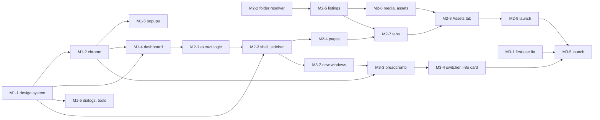

# Desktop redesign: development plan for Milestones 1–3

| | |
| --- | --- |
| Status | In implementation on `PabloWiedemann/desktop-redesign` (one commit per PR below) |
| Scope | Milestone 1 (Design system), Milestone 2 (Builds dashboard), Milestone 3 (Breadcrumb title bar) |
| Base | `origin/main` @ `07581832`. Line references were taken at `9c43562d`; the files they point to did not change in between, except small shifts in `src/main/index.ts`. |
| Visual source of truth | The design prototype (see [§3.1](#31-source-of-truth)). Its Prototype menu shows each milestone. |
| Product decisions | [desktop-redesign-decisions.md](desktop-redesign-decisions.md) records every decision taken during implementation. |

This plan turns the approved prototype into production code. Every screen reads real data. Nothing in production code is mock data, a placeholder value or an estimate we cannot compute.

The work is cut into **19 PRs**. Each one has one goal and can be reviewed in one sitting, but they are deliberately larger than the first draft (44 PRs): a PR now covers a whole surface or a whole data domain, not one component.

---

## Contents

1. [Summary](#1-summary)
2. [Decisions](#2-decisions)
3. [Design system contract](#3-design-system-contract)
4. [Engineering rules for every PR](#4-engineering-rules-for-every-pr)
5. [Milestone 1: Design system](#5-milestone-1-design-system)
6. [Milestone 2: Builds dashboard](#6-milestone-2-builds-dashboard)
7. [Milestone 3: Breadcrumb title bar](#7-milestone-3-breadcrumb-title-bar)
8. [Sequencing and parallel work](#8-sequencing-and-parallel-work)
9. [Risks](#9-risks)
10. [Not in these milestones](#10-not-in-these-milestones)

---

## 1. Summary

| Milestone | What users get | Rollout | PRs |
| --- | --- | --- | --- |
| **M1 Design system** | The new design system (tokens, components, gradients). The dashboard and everything it and its menus open are restyled: title bar, app menu, instance picker and Manage, Desktop Settings, downloads, tooltips, dialogs. Performance Tests and Benchmarks get the new palette only. | Lands directly on `main`, inside one release cycle | 5 |
| **M2 Builds dashboard** | Instances and builds become one concept, **Builds**. A sidebar of builds; **All builds** is the landing page; a page per build with **Workflows**, **Models & nodes** and **Assets** tabs; the workspace switcher at the foot of the sidebar. | Behind `newDashboardEnabled` until its launch PR | 9 |
| **M3 Breadcrumb title bar** | Every window's title bar becomes a breadcrumb: **Builds › build ⌄**. Hovering the build shows its info card; the chevron switches builds. Each build opens in its own window and the dashboard window stays. | Behind `breadcrumbTitleBarEnabled` until its launch PR (needs M2) | 5 |

---

## 2. Decisions

These were agreed before writing this plan. Decisions taken during implementation are in the [decision log](desktop-redesign-decisions.md).

| # | Decision | Consequence for the code |
| --- | --- | --- |
| D1 | The new **Void** palette reaches only the screens in scope for M1. | The install wizard, first-run takeover and progress screens keep today's colours and shapes. The palette is applied by scope, not by changing the shared variables ([§3.7](#37-legacy-palette-bridge)). |
| D2 | Performance Tests and Benchmarks get the **palette only** in M1. | They inherit the colours; their own components are not reworked. |
| D3 | M1 lands **directly**. M2 and M3 are **behind flags**. | M2 and M3 ship dark until their launch PRs. |
| D4 | The build page has **Workflows**, **Models & nodes** and **Assets** tabs. Activity and Versions are not in M2. | Each tab reads real data. Assets needs a media layer ([§6.4](#64-data-contracts)). |
| D5 | "Instance" and "build" become one concept, **Builds**, in **user-facing copy only**. | Code, IPC channels, types (`Installation`, `installationId`) and telemetry names keep the install vocabulary, and new code uses it too (`install-contents:*`, `install-switcher`, `InstallPage.vue`). |
| D6 | In M3 each build opens in **its own window**; the dashboard window stays. | M3 changes where launches go, not how many views a window has. |

---

## 3. Design system contract

Every M1–M3 surface uses the design system built in the prototype: its tokens, its components and its gradients. **Do not deviate from it.** No new colours, radii, shadows, font sizes or one-off components in feature PRs. If something cannot be built with the system, change the system first, in a design-system PR ([§3.9](#39-changing-the-design-system)).

### 3.1 Source of truth

- **Prototype code:** the worktree branch `PabloWiedemann/instances-landing-prototypes` (uncommitted; push it as a reference branch before the team starts reviewing). It is never merged.
  - Design system: `src/renderer/src/design/landing/ui/`.
  - Chrome skin: `src/renderer/src/assets/chrome-void.css`.
- **Prototype app:** run that branch and pick the milestone in the **Prototype** menu (sliders icon, title bar). UI PRs compare screenshots against that variant.

| Milestone | Copy the look from |
| --- | --- |
| M1 | `parts/milestones/ClassicDashboard.vue`, `parts/InstanceCard.vue`, `parts/NewInstanceCard.vue`, `assets/chrome-void.css` |
| M2 | `variants/VariantModes.vue`, `parts/env/SidebarGroup.vue`, `parts/WorkspaceMenu.vue`, `parts/ContextSwitchSub.vue`, `pages/modes/EnvironmentsList.vue`, `pages/modes/EnvironmentDetail.vue`, `pages/project/ProjectWorkflows.vue`, `pages/env/EnvModels.vue`, `pages/AssetsPage.vue` |
| M3 | `parts/nav/TitleBarBreadcrumb.vue`, `comfyTitlePopup/MenuView.vue` (rich rows) |

Only the prototype's **look** is the contract. Its local-storage bridge between windows, its mock data and its view-switching code are not copied.

### 3.2 Where it lives

```
src/renderer/src/design-system/
  index.css           imports the files below (imported once from assets/main.css)
  tokens.css          Tailwind v4 @theme static: colours, type, radius, shadow, blur, motion
  base.css            .ds-root scope, @layer base defaults, @utility heading-gradient / edge-shine
  surfaces.css        .ds-page (glass page), .glass-titlebar, .ds-content (content panel + glow), .ds-sidebar
  palette-void.css    everything that only applies under .palette-void (§3.7)
  cn.ts, portal.ts, menu.styles.ts
  components/         one .vue per component + its *.variants.ts
  README.md           rules, and token tables written from tokens.css
```

Renames: `.proto-ui` → `.ds-root`, `.proto-shell` → `.ds-page`, `.proto-main` → `.ds-content`, `.proto-sidebar` → `.ds-sidebar`.

### 3.3 Dependencies

`reka-ui` 2.6.2, `cva` 1.0.0-beta.4, `clsx` ^2.1.1, `tailwind-merge` ^3.7.0, at the prototype's versions. The ESLint override that turns off `vue/require-default-prop` applies to `src/renderer/src/design-system/**/*.vue` only.

### 3.4 Tokens

Port the prototype's `tokens.css` verbatim, with two differences:

- **`@theme static`**, because Tailwind v4 only emits a theme variable when a utility uses it, and legacy scoped CSS reads tokens as `var(--…)`.
- **The README token table** is rewritten from `tokens.css`; the prototype README lists tokens that do not exist (`micro`, `meta`, `body`, `inner`, `dialog`, `glass`, `scrim`, …).

| Group | Tokens |
| --- | --- |
| Surfaces | `app-background`, `content-background`, `card-background(-hover)`, `secondary-background(-hover)`, `media-overlay`, `titlebar-background` |
| Text | `base-foreground`, `muted-foreground`, `subtle-foreground` |
| Accent | `inverted-background(-hover)`, `inverted-foreground` |
| Borders | `border-default`, `border-strong`, `border-focus` |
| Status | `status-running`, `status-danger` |
| Type | `text-ui` 13/20, `text-heading` 16/24, `text-title` 22/28, `text-display` 34/40 |
| Radius | `panel` 16, `card` 12, `control` 8, `min` 4 |
| Shadow | `elev`, `elev-hover`, `popover`, `highlight` |
| Other | `blur-glass`, `ease-out-expo`, `animate-pop-in`, `animate-fade-in` |

Rules: semantic tokens only; 4px grid; nested radius (inner = outer − padding); dark only. In a build window the title bar takes ComfyUI's colour, so anything drawn there uses the title bar's own theme variables.

### 3.5 Components

Port a component only in the PR that first needs it. Prototype `parts/` are feature components: they are rebuilt from design-system components in the feature that uses them. `parts/GraphPreview.vue` draws a fake graph and is not ported.

| Ported in | Components |
| --- | --- |
| M1-1 | `Button`, `Input`, `SearchInput`, `DropdownMenuContent/Item/Label/Separator`, `Tooltip`, `Card`, `Badge`, `Avatar`, `StatusDot`, `LocationIcon` |
| M2-3 | `Tabs`, `SegmentedControl`, `Select`, `PageHeader`, `SectionHeader`, `EmptyState`, `MediaCard`, `DropdownMenuSubTrigger/SubContent` |

### 3.6 Surfaces and gradients

Copy byte for byte from the prototype's `surfaces.css` and `tokens.css`: the glass page (base oklch(0.19 0.003 285) plus sheen, warm, cool and mid washes, `--glass-y: -37px`), the title-bar glass, the content panel (8px inset, radius 16, overhead light, the baked teal and plum mesh, seed 7), the glow, `edge-shine` and `heading-gradient`. The prototype's browser-preview rules (`-44px`, `:has(> .glass-titlebar)`) are not ported.

### 3.7 Legacy palette bridge

Most in-scope chrome is legacy SFCs whose scoped CSS reads legacy variables. `palette-void.css` holds everything that only applies under `.palette-void`.

1. **Colours.** The legacy variables re-pointed to Void (layer 1 of `chrome-void.css`). Selector `:root.palette-void[data-theme='dark'], .palette-void`, so it out-ranks `main.css`'s `[data-theme='dark']` block on `<html>` and re-declares on a descendant. Derived variables are re-declared too, because a `:root` variable defined as `var(--neutral-800)` resolves at `:root`. The title bar colour is the glass base, `#141415`.
2. **Shared shapes.** Global legacy classes (`button.primary`, `button.brand-secondary`) and shared primitives also used by the wizard (`BaseSelect`, `BooleanToggle`) take their new shapes only under `.palette-void`. Components that only render in scope change their own scoped styles.
3. **Where the class goes.**
   - `<html>` of the title bar, title popup, tooltip and system modal renderers: everything they draw is in scope.
   - Panel renderer: never on `<html>` (the wizard lives there). On the roots of the dashboard, Performance Tests and Benchmarks, always on the teleported roots of the shared dialogs, and on teleported legacy elements (`BaseSelect`'s listbox, `ui/Tooltip`, `ContextMenu`, `WhyTryCloudModal`) only when they open inside a scope.
   - Teleported elements learn their scope through provide/inject: `providePaletteScope()` on the scoped root, `usePaletteScope()` on the teleported root (`composables/usePaletteScope.ts`).
4. **Accepted exception.** The shared dialog primitives (`ModalDialog`, `BaseModal`, `BaseAlert`, `AnnouncementModal`) take the Void palette everywhere, including over the wizard. One dialog style.

### 3.8 Main-process mirrors

Changed in the same PR as their renderer side, with their tests.

| Constant | Today | Void |
| --- | --- | --- |
| `TITLEBAR_BG` (`theme.ts`) | `#211927` | `#141415` |
| Update splash (`SPLASH_PURPLE.bg`) | follows `TITLEBAR_BG` | own constant, stays `#211927` |
| Coachmark theme (`titleCoachmark.ts`) | `#211927 / #ffffff / #38303d / #e3ff3c` | `#1c1c21 / #f1f1f3 / #2d2d31 / #f1f1f3` |
| Tooltip theme (`titleTooltip.ts`, `TitleTooltipApp.vue`) | `#211927 / #ffffff / #38303d` | `#f1f1f3 / #070709 / #f1f1f3` (inverted) |
| Popup scrim (`titlePopup.ts`) | `rgba(33,25,39,0.4)` | `rgba(10,10,11,0.4)` |
| `POPUP_ITEM_HEIGHT` (`titlePopup.ts`) | 28 | 32 |
| `COMFY_BG` | `#171717` | unchanged |

### 3.9 Changing the design system

Only design-system work edits `src/renderer/src/design-system/` (M1-1, M2-3). Feature code never does. A token change is a design decision with before/after screenshots.

---

## 4. Engineering rules for every PR

### 4.1 Principles

Write clean code (Robert C. Martin's *Clean Code*) and be frugal:

- **Smallest change that does the job.** One goal per PR, stated in one sentence.
- **No side quests.** No drive-by refactors, renames, formatting churn or dependency bumps. File an issue instead.
- **Reuse before adding.** This plan names the stores, composables and main-process functions to reuse. Add an abstraction only when a second real caller exists.
- **Minimal blast radius.** Flagged work proves with a test that nothing changes while its flag is off.
- **Delete what you replace,** in the same PR.
- **Intent-revealing names**, small functions, comments that explain why.
- **Real data or an honest empty state.** No mock data, placeholder numbers, fake previews or estimates.
- **Fail closed and visibly:** `{ ok: false, message }` and an error state.

### 4.2 Repository standards

| Rule | Reference |
| --- | --- |
| Conventional-commit PR titles. `feat`/`fix` for what users see on release (release notes are built from them), `chore` for plumbing and flagged work, `refactor` for no-behaviour changes, `test` for test-only work. | `version-bump.yml` |
| PR description has the change breakdown: product vs test code (files, paths, added, deleted, share), with docs, config, generated, lockfiles, locales and vendored code listed separately. | `AGENTS.md` |
| Typecheck, lint and `format:check` pass (husky pre-commit); unit, integration and E2E pass in CI on macOS, Windows and Linux. | `.husky/pre-commit`, `ci.yml` |
| Zero flaky tests: no fixed sleeps, `expect.poll`, fake timers. | `AGENTS.md`, `TESTING.md` |
| User-facing strings through `t()` / `i18n.t()`, in `en.json` and `zh.json` with the same placeholders. | `localeCoverage.test.ts` |
| IPC types in `src/types/ipc.ts`, preload in `buildElectronApi`, handlers in `register<Domain>Handlers.ts`; input validated as `unknown`; `{ ok, message }` results. | `ipc/index.ts` |
| New settings declare a telemetry policy; `data-testid` only through `TID`. | `settings.ts`, `testIds.ts` |

### 4.3 PR size

- **Target: under 800 changed lines of product code** (tests, locales and lockfiles not counted). Verbatim design-system ports and CSS-only restyles may go over; anything else over 1,000 is split.
- Every PR leaves `main` releasable. Stacked PRs target the PR below them.

### 4.4 Testing

- Unit tests next to their source (`*.test.ts`): components with i18n and Pinia, a typed `MockApi`, IPC handlers with `vi.mock('electron')`.
- CSS computed values cannot be tested in Vitest (happy-dom, no Tailwind); they are covered by screenshot QA and, where it matters, e2e through `e2e/support/cdpPages.ts`.
- Flag-off safety: every flagged renderer change has a flag-off test; flagged main-process handlers refuse while the flag is off.
- **E2E runs in CI.** On a developer Mac the harness writes into the real `~/Library/Application Support/comfyui-desktop-2`; never run it there without backing that folder up.
- Lifecycle tests (`@lifecycle`) run with the `run-lifecycle` label; add it to PRs that touch launch routing (M2-2, M3-2).

---

## 5. Milestone 1: Design system

**Goal.** Ship the design system, and restyle the dashboard and everything it and its menus open, to match the prototype's Milestone 1. Layout and words stay as they are ("Instances", "New Instance").

**Out of scope:** the install wizard, `TrackModal`, `LoadSnapshotModal`, `QuickInstallModal`, `FirstUseTakeover`, `MigrateConfirmTakeover`, `ProgressModal`, Brand* takeovers, the lifecycle view, and dead code nothing mounts (`ManageInstallModal`, `DetailModal`, `SnapshotTab`, `ConsoleModal`, `components/TitleBar.vue`, …).

### M1-1 `chore(design-system): add the design system`

- **Depends on:** nothing.
- **Changes:**
  - Dependencies and the scoped ESLint override ([§3.3](#33-dependencies)).
  - `src/renderer/src/design-system/` ([§3.2](#32-where-it-lives)): tokens (`@theme static`), base, surfaces, `palette-void.css` (colours and shared shapes, [§3.7](#37-legacy-palette-bridge)), `cn.ts`, `portal.ts`, `menu.styles.ts`, README, and the M1 components ([§3.5](#35-components)).
  - `composables/usePaletteScope.ts`.
  - Imported once from `assets/main.css`. Nothing uses the classes yet: no visual change.
- **Tests:** `cn()` merges the custom scales; component variants render their classes; `Button` forwards `disabled`; `SearchInput` emits `update:modelValue`; `usePaletteScope` returns the class only under a provided scope.

### M1-2 `feat(chrome): new design for the title bar, menus and tooltips`

- **Depends on:** M1-1.
- **Changes:**
  - `palette-void` on `<html>` in the title bar, title popup, tooltip and system modal renderers.
  - The main-process mirrors ([§3.8](#38-main-process-mirrors)), with the update splash on its own constant.
  - `TitleBarApp.vue`: 8px ghost buttons, the install pill's quiet field, a hairline border; `.glass-titlebar` on the dashboard window's dark bar.
  - `MenuView.vue` and `TitlePopupApp.vue`: 4px menu padding, 32px rows with 8px radius, 12px menus, 16px centred cards, inset highlight; `POPUP_ITEM_HEIGHT` 32.
  - `TitleTooltipApp.vue` defaults (inverted tooltip).
- **Tests:** theme, tooltip, coachmark and popup-height tests updated; `glass-titlebar` only on install-less dark bars.

### M1-3 `feat(chrome): new design for the instance picker, Manage, Desktop Settings and downloads`

- **Depends on:** M1-2.
- **Changes:** scoped styles of `InstancePickerView`, `InstanceRow`, `ComfyUISettingsContent` and `views/comfyUISettings/*`, `GlobalSettingsView`, `DownloadsView`, `DownloadsFullView`, per `chrome-void.css` layer 2. `BaseSelect`'s listbox and `ui/Tooltip` bind `usePaletteScope()`.
- **Tests:** screenshot QA; the wizard's selects and buttons are unchanged.

### M1-4 `feat(dashboard): new design for the dashboard`

- **Depends on:** M1-1, M1-2.
- **Changes:**
  - `ChooserView`: `.ds-root` + `.ds-page` + `.ds-content`, `providePaletteScope()` on the root; header per `ClassicDashboard.vue` (account at the top right, the wordmark as a `heading-gradient` display title, `SearchInput`, the workspace bar with `INSTANCES n`). `BrandBackground` and `BaseInput` leave the dashboard.
  - Tiles: `ChooserInstallTile` and the New Instance tile rebuilt with `Card`, `Badge`, `StatusDot`, `Button` and `LocationIcon`, keeping every state (running, starting, stopping, error, update, migrate, install failed, TRY FREE, Why Try Cloud, kebab). `chooser-tiles.css` is deleted.
  - Menus: `ContextMenu` restyled with `floatingSurface` / `menuItem` and `usePaletteScope()`; `WhyTryCloudModal` restyled with `usePaletteScope()`.
  - `main.css` rules made unused are deleted.
- **Tests:** existing `ChooserView`, tile and context-menu tests pass with their test ids.

### M1-5 `feat(dialogs): new design for dialogs, and the new palette for Performance Tests and Benchmarks`

- **Depends on:** M1-1.
- **Changes:** `palette-void` on the teleported roots of `ModalDialog`, `BaseModal`, `BaseAlert` and `AnnouncementModal`, with their shapes on tokens (radius 16); `providePaletteScope()` on the roots of `PerformanceTestView` and `BenchmarksView`.
- **Tests:** each teleported dialog root carries `palette-void`.

---

## 6. Milestone 2: Builds dashboard

**Goal.** Behind `newDashboardEnabled`, replace the dashboard with the prototype's Milestone 2: a sidebar of builds, **All builds** as the landing page, a page per build with **Workflows**, **Models & nodes** and **Assets**, and the workspace switcher at the foot of the sidebar. Launching keeps today's behaviour (M3 changes it).

### 6.1 Architecture

- **One new view.** With the flag on, `PanelApp` mounts `views/dashboard/DashboardView.vue` instead of `ChooserView`. It emits the same `pick`, `show-new-install` and `show-progress` events, so the launch, wizard and progress wiring is reused.
- **The flag reaches the page synchronously**, through the panel URL query (`panelView.ts`, read by `useLauncherPrefs`).
- **The flag is not a defaulted key**, because `settings.set()` writes defaults to disk. Main reads it as `get('newDashboardEnabled') ?? NEW_DASHBOARD_DEFAULT`; the launch PR changes the constant.
- **Shared logic is extracted** from `ChooserView` into composables (M2-1), not copied.
- **Data comes from main** through one IPC domain, `install-contents:*` (`registerInstallContentsHandlers.ts`).
- **One folder resolver** (M2-2) returns the folders the build's ComfyUI uses, built from launch's own code: the input/output rule moves out of `applyStorageLaunchArgs`; models come from `resolveDownloadContext`; user and custom-node folders follow `--base-directory` / `--user-directory` (adopted installs pin them).

### 6.2 Data contracts

The ComfyUI asset database (`--enable-assets`) is still off by default (opt-in through v0.41.2; master turned it on on 9 Oct 2026 and off again on 12 Oct 2026). So local builds are read from their files; Comfy Cloud through its HTTP API.

| Tab | Local and adopted builds | Comfy Cloud |
| --- | --- | --- |
| Workflows | Walk `<user>/default/workflows/**/*.json` | `GET /api/userdata?dir=workflows&recurse=true&split=false&full_info=true` |
| Models | Walk the model roots and extra model paths, grouped by folder | `GET /api/assets?include_tags=models` |
| Nodes | `scanCustomNodes` on the build's `custom_nodes` | Managed: designed empty state, no call |
| Assets | Scan the output and input folders: images, video, audio, newest first | `GET /api/assets?include_tags=output` |

Signed out of Cloud: an empty state with Log in. Remote builds: a designed empty state, no call.

**Listing contract.** Request `(installationId, { query?, sort?, cursor?, limit? })`; response `{ ok: true, items, nextCursor, total, truncated }` or `{ ok: false, message, signedOut? }`. Handlers read up to a cap, filter, sort, then page. Counts show `total`, with a plus when truncated.

**Media.** The panel CSP cannot show `file://` images, so main serves them through a `comfy-media://` protocol: only files inside the build's resolved folders, no traversal or symlink escape, byte ranges for video and audio, default session only.

### 6.3 PRs

#### M2-1 `refactor(dashboard): extract the dashboard logic from ChooserView`

- **Depends on:** M1-4.
- **Changes:** `pickInstall`, `canPromoteToWorkspace`, the workspace prefetch watcher and the Cloud tier fetch move into composables in `src/renderer/src/composables/`. No behaviour change.
- **Tests:** `ChooserView.test.ts` unchanged; the composables get unit tests.

#### M2-2 `refactor(installs): one resolver for an install's folders`

- **Depends on:** nothing.
- **Changes:** `src/main/lib/installFolders.ts` (`resolveInstallFolders`); `applyStorageLaunchArgs` calls it for input and output. Launch arguments are byte-identical.
- **Tests:** existing launch storage tests unchanged; the resolver for standard, adopted, shared and per-install folders.

#### M2-3 `chore(dashboard): new dashboard shell and sidebar behind newDashboardEnabled`

- **Depends on:** M1-1, M2-1.
- **Changes:** the setting (hidden, telemetry policy `value`); the panel URL query; the M2 design-system components ([§3.5](#35-components)); `DashboardView` with the 236px sidebar (Builds heading with **+**, **All builds** with its count, one row per build in the selected workspace) and the foot (workspace switcher, account, Log in / Sign out).
- **Tests:** the flag stays out of `settings.json`; `PanelApp` mounts the old view with the flag off; sidebar rows follow the stores.

#### M2-4 `chore(dashboard): All builds page and build page`

- **Depends on:** M2-3.
- **Changes:**
  - All builds (`InstallListPage.vue`): **Builds** header with **New build**, filter `All · This computer · Cloud` with counts, cards with status, runs-on, **Open/Start ComfyUI** and the existing kebab; every tile state carries over.
  - Build page (`InstallPage.vue`): back, icon, name, version, status, kind; **Start/Open**, **Stop**, kebab with **Manage**; an empty `Tabs` frame.
- **Tests:** filter, launch, kebab, states, empty workspace; actions per build state.

#### M2-5 `chore(installs): list a build's workflows, models and nodes`

- **Depends on:** M2-2.
- **Changes:** the `install-contents:*` contract (all channels) in `types/ipc.ts` and the preload; `registerInstallContentsHandlers.ts`; the workflows, models and nodes listings ([§6.2](#62-data-contracts)), local and Cloud; refusal while the flag is off.
- **Tests:** local walks (temp dirs) with query, sort, paging and the cap; Cloud happy path, 401 and signed out; invalid input refused; flag-off refusal.

#### M2-6 `chore(media): serve build media and list a build's assets`

- **Depends on:** M2-5. **Review with security in mind.**
- **Changes:** the `comfy-media` scheme and handler; `comfy-media:` in the panel CSP; the assets listing; `install-contents:reveal-asset` (`shell.showItemInFolder`, same folder check).
- **Tests:** traversal and escapes refused; allowed file served with its type; range requests; flag-off refusal; reveal refused outside the folders.

#### M2-7 `chore(dashboard): Workflows and Models & nodes tabs`

- **Depends on:** M2-4, M2-5.
- **Changes:** `useInstallContents` (paging, search, sort, refresh, stale-response guard); the Workflows tab (search, sort, cards with name, folder and time; Open launches the build); the Models & nodes tab (`SegmentedControl` Models | Custom nodes, counts, search, rows).
- **Tests:** loading, empty, error and signed-out states; paging; search; stale responses dropped.

#### M2-8 `chore(dashboard): Assets tab`

- **Depends on:** M2-6, M2-7.
- **Changes:** a `MediaCard` grid served by `comfy-media://`, a type filter, newest first; click reveals a local asset in the file browser; Cloud assets are view-only.
- **Tests:** states, filter, reveal.

#### M2-9 `feat(dashboard): launch the Builds dashboard`

- **Depends on:** M2-8.
- **Changes:** `NEW_DASHBOARD_DEFAULT = true`; user-facing copy "instance" → "build" on the in-scope surfaces in en and zh (the wizard, progress and first-run screens keep "instance"); e2e for the new dashboard.

---

## 7. Milestone 3: Breadcrumb title bar

**Goal.** Behind `breadcrumbTitleBarEnabled` (effective only with `newDashboardEnabled`), every window's title bar becomes **Builds › build ⌄**: hovering the build shows its info card, the chevron opens the build switcher, the root focuses the dashboard, and each build opens in its own window.

### 7.1 Architecture

- The flag reaches the title bar (URL query in `loadTitleBarUrl`), the panel (URL query) and the popups (config).
- Launches reuse existing paths: `performPickerLaunch` (launch guards, no claim, so the build opens in its own window) in the panel; `openInstallInNewWindow` in main. Not `open-install-window`, which opens an empty dashboard.
- Switcher and info-card rows are composed in main from the install cache and running sessions and sent in the popup config; the picker's rebroadcast is extended to the new kinds.
- Two new popup kinds, `install-switcher` and `install-info`, rendered with `menu.styles` classes. The info card opens without focus; main closes it on Escape.

### 7.2 What the centre pill did

| Today (pill) | With the breadcrumb |
| --- | --- |
| Identity (icon, name) | Build crumb |
| Opens the instance picker (the route to Manage) | Info card → **Settings & updates** |
| Install update chip | Same chip, next to the build crumb |
| Onboarding coachmark anchor | Anchors to the chevron |
| First-use lockdown | Unchanged: no breadcrumb during lockdown |

### 7.3 PRs

#### M3-1 `fix(windows): apply the first-use mode to the window that sent it`

- **Depends on:** nothing.
- **Changes:** delete the stray `return` in the `set-first-use-mode` handler that ends the loop after the first window.
- **Tests:** two windows; the mode lands on the sender only.

#### M3-2 `chore(windows): open builds in their own window behind breadcrumbTitleBarEnabled`

- **Depends on:** M2-3.
- **Changes:** the setting and its propagation; with the flag on, dashboard picks launch through `performPickerLaunch`, `handleShowProgress` skips the claim, and picker picks from a dashboard host go to `openInstallInNewWindow`. The dashboard window never turns into a build or closes itself.
- **Tests:** claim and self-close only with the flag off; picker routing both ways.

#### M3-3 `chore(title-bar): breadcrumb layout`

- **Depends on:** M1-2, M3-2.
- **Changes:** under the flag, `TitleBarApp` is left-aligned: root crumb (**Builds**), **›**, build crumb (build windows), chevron; the app menu moves right; the dashboard window shows **Builds › Open a build ⌄**. The root crumb focuses the dashboard (`comfy-window:focus-dashboard` → `openOrFocusChooserHostWindow`). Pill duties move per [§7.2](#72-what-the-centre-pill-did). Popup plumbing for both new kinds.
- **Tests:** flag off unchanged; flag on renders the crumbs, keeps the update chip, hides the breadcrumb in lockdown.

#### M3-4 `chore(title-bar): build switcher and info card`

- **Depends on:** M3-3.
- **Changes:**
  - Switcher (320px): **All builds**, **Open**, **Recently used**, **Manage builds**; each row with location icon, status dot, name, state (Running / Starting… / Not running), last used, **Current**. Picking opens or focuses that build's window.
  - Info card (hover 350ms in, 250ms out; click opens; Escape closes): status, type, ComfyUI version, location, last used, update; **Settings & updates**, **Open folder** (local), **Close window**.
- **Tests:** row composition and order; routing; info-card composition per kind; handshake timing with fake timers.

#### M3-5 `feat(title-bar): launch the breadcrumb title bar`

- **Depends on:** M2-9, M3-1, M3-4.
- **Changes:** `BREADCRUMB_TITLE_BAR_DEFAULT = true`; copy check in en and zh; e2e.

---

## 8. Sequencing and parallel work



| Lane | PRs | Notes |
| --- | --- | --- |
| Design system and chrome | M1-1 → M1-2 → M1-3; M1-5 | M1-5 runs in parallel with M1-2. |
| Dashboard | M1-4 → M2-1 → M2-3 → M2-4 → M2-7 → M2-8 → M2-9 | |
| Main-process data | M2-2 → M2-5 → M2-6 | Can start on day one; invisible until the UI calls it. |
| Windows and title bar | M3-1 (any time); M3-2 → M3-3 → M3-4 → M3-5 | |

With three engineers: one per lane, the third (data) moving to the windows lane once M2-6 is in.

---

## 9. Risks

| Risk | Mitigation |
| --- | --- |
| M1 half-merged at a release cut | Merge window agreed with the release owner; each M1 PR is coherent alone. |
| The palette bridge misses a variable or loses to `[data-theme]` | `:root.palette-void[data-theme='dark']` selector; derived variables re-declared; screenshot QA. |
| A teleported legacy element misses the class | One mechanism (`usePaletteScope`) and a test per teleported root. |
| Flag defaults written to `settings.json` | Flags are not defaulted keys; tests assert they stay out of the file. |
| Wrong folders for adopted or shared-folder installs | One resolver built from launch's code (M2-2). |
| Media protocol exposes files | Resolver-allowed folders only, real-path checks, traversal tests, security review on M2-6. |
| Breadcrumb drops a pill duty | [§7.2](#72-what-the-centre-pill-did) table, each duty tested. |
| E2E run on a developer Mac | CI only, or a backed-up profile. |

---

## 10. Not in these milestones

- Opening a specific saved workflow from Desktop (needs a ComfyUI frontend hook).
- The asset API upgrade for running local builds, once `--enable-assets` is on by default.
- Activity and Versions tabs; "Couldn't start" in the switcher; contents of remote builds.
- Home (M4), Explore and Learn (M5), Builder (M6), one window holding many builds.
- Restyling the wizard, first-run and progress screens; deleting dead UI code; light theme; real window glass.
- Removing the flags and `ChooserView`, one release after each launch.
